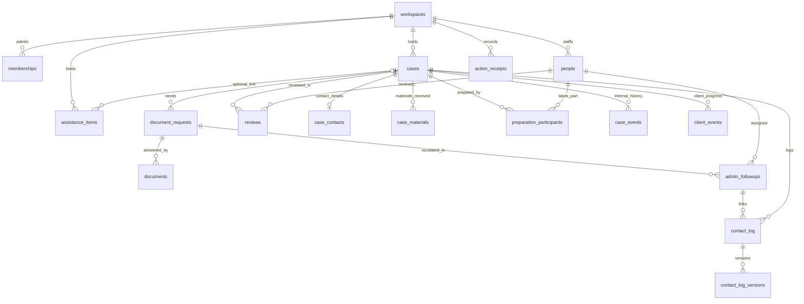
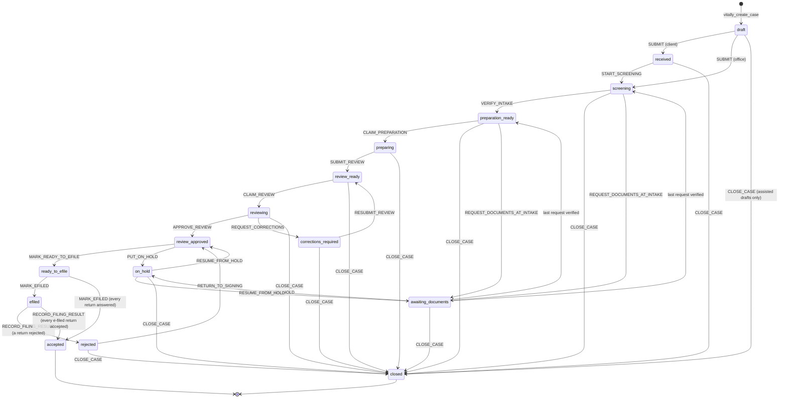

# Database

PostgreSQL on Supabase is ViTally's back end. It holds the data, decides who can read which rows,
and runs every workflow change inside one function call. This page is the reference for all of
it. Run everything described here against the local stack from [`docs/setup.md`](../setup.md).

## Contents

- [Migrations](#migrations)
- [Schema](#schema)
- [Who can see what](#who-can-see-what)
- [The action API](#the-action-api)
- [The case state machine](#the-case-state-machine)
- [Action catalogue](#action-catalogue)
- [The shaded section of the 13614-C](#the-shaded-section-of-the-13614-c)
- [Season-end close](#season-end-close)
- [The contact log](#the-contact-log)
- [Case labels](#case-labels)
- [Check order and error codes](#check-order-and-error-codes)
- [Concurrency and idempotency](#concurrency-and-idempotency)
- [Realtime](#realtime)
- [Changing the database](#changing-the-database)
- [Recipes](#recipes)
- [Testing](#testing)

## Migrations

The schema is fifty-one plain SQL files (001 to 051) in [`supabase/migrations/`](../../supabase/migrations/), applied
in order by [`tools/admin/migrate.mjs`](../../tools/admin/migrate.mjs).

| File | Adds |
| --- | --- |
| `001_identity_and_cases.sql` | Workspaces, memberships, people, cases, action receipts; `vitally_create_case`; the workspace initializer; base RLS |
| `002_workflow_schema.sql` | Document requests, documents, admin follow-ups, contact attempts, internal and client history, participation, assistance items; their RLS |
| `003_action_core.sql` | `vitally_apply_action` and its shared checks; intake actions and the preparation claim |
| `004_documents_followup.sql` | Document request/response/verification; admin follow-up escalation, contact, resolution |
| `005_assistance_closure.sql` | Assistance items' own entry point; reminders; case closure |
| `006_review.sql` | The `reviews` table and every review action; the final version of the dispatcher |
| `007_realtime_publication.sql` | The twelve tables published to Realtime, INSERT and UPDATE only |
| `008_case_timestamps.sql` | `cases.created_at` and `cases.updated_at`; the final `commit_action` |
| `009_fixtures_and_realtime.sql` | Six sample cases, presenter reset, checkpoints (demo only) |
| `010_client_numbers.sql` | `workspaces.current_season`; `cases.season` and `client_number` (one per submitted case in each workspace and season), assigned by a trigger on submit |
| `011_intake_v2.sql` | The version-2 intake, schema only: `workspaces.default_intake_version` and `cases.intake_version`; the private `intake_fields` catalogue table and its loader; value, visibility and missing-field checks; `case_contacts`; version-2 SAVE_ANSWERS and SUBMIT |
| `012_intake_catalogue_<hash8>.sql` | Generated by `npm run build:intake`: the first load of the version-2 catalogue into `intake_fields` |
| `013_contact_materials.sql` | `case_materials`; the UPDATE_CONTACT and RECORD_MATERIALS actions |
| `014_intake_catalogue_<hash8>.sql` | Generated in part 4b: reloads the same catalogue rows as 012. It exists because part 4b renamed three step titles, and the hash covers the whole catalogue (see below) |
| `015_intake_loader.sql` | The loader for the redesigned catalogue: the hidden `id` field type (`hh.member_id`); the private `intake_substeps` table, one row per sub-step in order; household members refused without a well-formed, unique `member_id` |
| `016_intake_catalogue_<hash8>.sql` | Generated: the redesigned catalogue (steps 0–9 with sub-steps), loaded through 015 |
| `017_documents_and_visits.sql` | `cases.intake_visited`; `case_document_cards`; `document_card_rules()`; the SET_DOCUMENT_CARD and SET_DOCUMENT_GROUP actions; SAVE_ANSWERS takes an optional `visited` list |
| `018_document_card_authority.sql` | Card authority: SET_DOCUMENT_CARD and SET_DOCUMENT_GROUP for staff who work on the case (`works_on_case`: office staff on any case, a volunteer as its preparer or reviewer), no longer a capability |
| `019_fixtures_v2.sql` | Samples follow the workspace's version: version-2 samples (answers, a `case_contacts` row, a household member with a fixed `member_id`) in a version-2 workspace; a checkpoint reload clears the sample's materials and card marks |
| `020_intake_v2_default.sql` | The switch-over: version 2 is the default intake version (column default and every workspace). Redefines no function, so it gives the same result before or after 021 and 022. Existing cases kept their version until 023 |
| `021_review_approved_message.sql` | The review-approved history line says signing and filing come next; `act_approve_review` (006) and `fixture_history` (009) copied with only that sentence changed |
| `022_intake_catalogue_<hash8>.sql` | Generated: the wording review's catalogue text (upload tips that list several documents say "them") |
| `023_remove_intake_v1.sql` | Version 2 is the only intake version. The rule as two pure predicates (`version_one_blocks`, `version_one_disposable`) and a count (`version_one_blockers`); a guard that refuses while a version-1 case exists that is neither a sample nor in a test workspace; the cleanup of the rest (children cascade, `fixture_generation` moves); every workspace set to 2; the functions below redefined without their version-1 paths; `intake_answer_keys` and `fixture_answers` dropped; both version `CHECK`s narrowed to 2 |
| `024_intake_catalogue_59560589.sql` | Generated: the household middle name (`hh.middle_name`), and `gcf_tp_signature`/`gcf_sp_signature` required to submit when shown |
| `025_intake_catalogue_194034c5.sql` | Generated by `npm run build:intake`: not-married wording for Q5.2, Q9.1a, Q12.4, the nine income/expense/event leads and section 6's intro; the senior leads say 您爱人 (text only); for an unmarried client, Q5.3–Q5.9 ask directly and every "who" question offers Yes/No |
| `026_intake_catalogue_2239685d.sql` | Generated by `npm run build:intake`: Q0.5 `language_also` (the client's other service languages, multi-select, optional) and Q0.6 `language_also_other` (its "Please specify", shown if Q0.5 includes Other) |
| `027_intake_show_if_any_and_year_range.sql` | Hand-written: `intake_holds` reads the show-if conditions `gte`, `lte` (a whole number at least or at most `value`) and `any` (one of its AND groups holds); the loader checks them through the new `intake_show_if_ok`; `check_intake_value` applies a year's `min_value`/`max_value` |
| `028_intake_catalogue_40593b97.sql` | Generated by `npm run build:intake`: the spouse questions follow rule `spouse_on_return` (married, or widowed with the death from 2023 to 2025) or rule `joint_possible` (married, or a 2025 death); `spouse_death_year` is 1900–2025 |
| `029_intake_catalogue_9ee07ca8.sql` | Generated by `npm run build:intake`: Sections 15 and 16, the Form 14446 consent at 0.4 and the signatures at 1.5 |
| `030_fixture_answers_14446.sql` | Hand-written: the sample cases' Form 14446 answers |
| `031_contact_log.sql` | Hand-written: the contact log (`contact_log`, `contact_log_versions`), its two functions `vitally_log_contact` and `vitally_edit_contact`, the one-time move of the old call attempts, `RECORD_CONTACT` refusing new requests, and the fixture change |
| `032_screening_and_efiling_stages.sql` | Hand-written: the `screening`, `ready_to_efile` and `efiled` stages, `START_SCREENING`, `MARK_READY_TO_EFILE` and `MARK_EFILED`, `VERIFY_INTAKE` from `screening`, an office submit landing in `screening`, and `CLOSE_CASE` from `screening` |
| `033_review_questionnaires.sql` | Hand-written: `preparer_questionnaires` and `reviewer_questionnaires` (staff-only), `admin_followups.purpose` and a nullable `request_id`, `cases.signing_plan` and `signing_appointment_at`; `SUBMIT_REVIEW`, `RESUBMIT_REVIEW` and `APPROVE_REVIEW` take a questionnaire; an approval settles the contact step and, when the reviewer did not go over the return, opens a `go_over_return` task for the office; `MARK_READY_TO_EFILE` waits for an open go-over task; the sample cases seed questionnaires |
| `034_screening_checks.sql` | Hand-written: `VERIFY_INTAKE` records the real screening checks, `phone`, `documents` and `in_scope`, plus `identity` only when the case's `service` answer is `online` (a replayed old four-key payload is refused); the client's history line is "PCDC finished screening your application. A volunteer will start preparing your return next."; `check_payload`, `act_verify_intake` and `fixture_history` replaced, and the sample cases record the new checks |
| `035_post_efiling_stages.sql` | Hand-written: the `rejected` and `accepted` stages; `cases.federal_method`, `state_method`, `federal_result` and `state_result`; the staff-only `filing_attempts`, `filing_returns` and append-only `filing_notes`; `MARK_EFILED` records each return's method; `RECORD_FILING_RESULT` and `RETURN_TO_SIGNING`; `CLOSE_CASE` from `rejected`; the `rejected` and `accepted` sample cases |
| `036_hold_and_closing.sql` | Hand-written: the `awaiting_documents` and `on_hold` stages; `cases.documents_origin`, `hold_origin` and `closing_reason`; `REQUEST_DOCUMENTS_AT_INTAKE`, `PUT_ON_HOLD`, `RESUME_FROM_HOLD` and the client's `WITHDRAW`; `CLOSE_CASE` takes one of six reasons and an optional note, and is also allowed from the two new stages; an admin may record and verify documents there; the `withdrawal_notice` follow-up purpose; the `on_hold` and `withdrawn` sample cases |
| `037_adjust_filing_to_pcdc.sql` | Hand-written: a paper return is "given to the client" at `MARK_EFILED` (stored result `given_to_client`, no date; the old `mailed` is renamed and its date dropped); all four federal/state method pairs are allowed; `RECORD_FILING_RESULT` takes e-filed returns only and `MARK_EFILED` moves the case straight to `accepted` when no e-filed return waits; the client line of `MARK_READY_TO_EFILE` no longer names Form 8879; the new RPC `vitally_close_unsigned`; the `rejected` sample's fix note is the site coordinator's |
| `038_staff_identity.sql` | Hand-written: the `staff` membership access and `people.user_id`, with a commit-time check that links them; `vitally_private.acting_person`, which the six entry points that take a person now call first; `staff` accepted wherever staff behaviour is decided (21 policies, `lock_case`, `lock_assistance_item`, `contact_person`, `check_operation_authority`'s guard, assisted mode and the two contact-log checks); the private `add_staff_member` and `set_default_followup`; `initialize_workspace` re-runs once staff exist. The header holds the inventory of every `'presenter'` check and what was decided for each |
| `039_preparer_shaded_fields.sql` | Hand-written: the shaded section of Form 13614-C, filled by the case's preparer: the staff-only `preparer_shaded_fields` table (one row per case, in the Realtime publication), `vitally_private.check_preparer_fields`, and the `SAVE_PREPARER_FIELDS` action with its version guard; the sample cases that have a preparer questionnaire get a fictional shaded row |
| `040_remove_sample_case_tools.sql` | Hand-written: the sample cases, the reset and checkpoint functions and their helpers, `vitally_private.fixture_client_bindings`, `cases.fixture`, `cases.fixture_key`, `assistance_items.fixture`, `workspaces.fixture_generation` and `action_receipts.generation` are removed; `origin` accepts only `client` and `assisted`; `initialize_workspace` loses its bindings parameter. No `CASCADE`: each dependent is dropped or rewritten by name |
| `041_resolve_go_over_during_hold.sql` | Hand-written: `act_resolve_followup` copied from 033; resolving a `go_over_return` task while the case is `on_hold` with `hold_origin = 'review_approved'` also switches `signing_plan` to the reviewer's method, as at Ready to exit (#171) |
| `042_let_follow_up_holders_work_any_follow_up.sql` | Hand-written: `lock_open_followup` no longer checks the assignee, so anyone holding `followup` works any open office follow-up (a contact linked to a missing or other-case task is still `FORBIDDEN`, and a resolve naming one stays `VALIDATION`); `add_staff_member`, copied from 038, refuses `followup` without `admin`; the check `people_followup_needs_admin` (#172) |
| `043_remove_presenter_access.sql` | Hand-written: the `presenter` access type, the person parameter (`p_person_id`) of the six RPCs and the demonstration people (Alex, Morgan, Sam) are removed. It refuses with `VT008` if a presenter account is referenced ([setup](../setup.md#migration-failed-vt008)); deletes the presenter receipts, memberships and accounts and the demonstration people nothing references; re-adds the access check as `applicant` and `staff`; changes the 22 policies to `m.access = 'staff'` and renames the 16 `presenter_*` policies to `staff_*`; replaces `acting_person`, the six RPCs and `initialize_workspace`; and rewrites `check_operation_authority`, `contact_person`, `lock_case`, `lock_assistance_item`, `act_close_case` and `add_staff_member` |
| `044_volunteer_roster_records.sql` | Hand-written: the admin-only records behind Volunteers > Roster. The new schema `vitally_policy` holds only `is_workspace_admin(workspace)`, a `security definer` check that answers for the caller alone, used by row policies that must read `people` without recursing into its own policy (it is not an API: PostgREST exposes only `public`); the tables `volunteer_profiles`, `roster_entries` and `certificates` (read by admins only, written only by `vitally_save_volunteer`, not published to Realtime); `staff_people` now hides a person with no sign-in and no capabilities from everyone but an admin; `add_staff_member` links a matching volunteer with no sign-in by email; existing staff get a profile and an empty roster entry, with no roles inferred. Roles and certificates grant nothing: `people.capabilities` is untouched (045 changes this) |
| `045_volunteer_clearance.sql` | Hand-written: volunteer clearance ([roster clearance](#roster-clearance)). A guard refuses with `VT008` if a person with a sign-in holds a current-season role their confirmed certificates don't support ([setup](../setup.md#045s-guard)), and strips such roles from people with no sign-in; `roster_entries.is_new` and `photo_id_checked_at`; the private role helpers (`confirmed_certificates`, `missing_certificates`, `role_capabilities`, `effective_capabilities`, `cleared`); the deferred constraint triggers `roster_entries_role_certificates` and `certificates_role_certificates`; the read gate `vitally_policy.cleared_workspace_id()` on the staff branch of the 21 case-data policies; `require_cleared` (`VT009` `NOT_CLEARED`) in the six case RPCs; `acting_person`, `check_operation_authority` and `contact_person` return the effective capabilities; the RPC `vitally_my_clearance`; `require_cleared_assignee` (no caller yet); `open_work`; and `vitally_save_volunteer` with role needs (`VT007` `ROLE_NEEDS`), the photo ID check and the open-work rule (`VT004` `OPEN_WORK`) |
| `046_volunteer_workload.sql` | Hand-written: the admin Workload's one write, the case action `ASSIGN_CASE` `{slot, personId, expectedHolderId}` (`vitally_private.act_assign_case`), added to `vitally_apply_action`, `check_operation_authority` (admin-only group) and `check_payload`, each re-created from its latest definition. No new table, column or Realtime change: the page reads what the staff window already holds |
| `047_accounts.sql` | Hand-written: sign-in accounts (change `add-account-invitations`). The `accounts` table (one row per membership: `invited`, `active` or `deactivated`, with `expires_at` and site-check attempts), admin-only to read; a backfill giving every existing membership a row; a trigger on `auth.users` that activates a client's invitation at first sign-in and cancels an expired one; triggers on the six tables that refer to a membership, activating an invited client's account at first use; an expiry sweep that leaves an invitation in use alone and skips (and logs) one it cannot cancel; `add_staff_member` and `initialize_workspace` writing active accounts; `cleared` requiring an active account; `vitally_private.site_numbers` (the site's SIDN, set by the roster command, unreadable through the API) and `volunteer_profiles.signed_in_name`; the RPCs `vitally_prepare_account`, `vitally_record_account`, `vitally_deactivate_account`, `vitally_reactivate_account`, `vitally_client_invitations`, `vitally_cancel_invitation`, `vitally_expire_invitations`, `vitally_complete_site_check` and `vitally_activate_client_account`; and `vitally_my_clearance` with `siteCheck` |
| `048_closed_lines_after_filing.sql` | Hand-written: a close after a filing says what was filed (issue #170, change `fix-closed-lines-after-filing`). `vitally_private.return_outcome` (one return: accepted, waiting, on paper or not filed) and a five-argument `vitally_private.closed_line` (the reason and each return's method and result) that replaces 036's `closed_line(text)`, which is dropped; `act_close_case` passes the case's filing columns and words the staff notice for a close after a filing; `vitally_close_unsigned` passes them too. No table, policy, RPC signature or Realtime change ([closing after a filing](#closing-after-a-filing)) |
| `049_posted_updates.sql` | Hand-written: posted updates ([below](#posted-updates)). The tables `posted_updates` and `update_reads`, written only through the RPCs; the live audience `vitally_private.audience_member` and the policy helper `vitally_policy.in_update_audience`; two SELECT policies on `posted_updates` (the audience reads an unpublished update only for `vitally_policy.unpublished_read_window()`, 10 minutes, after Unpublish) and none on `update_reads`; the RPCs `vitally_save_update` and `vitally_update_action` (workspace admins, with receipts), `vitally_mark_updates` and `vitally_my_updates` (every staff member, cleared or not) and `vitally_posted_updates` (workspace admins); `posted_updates` joins the Realtime publication and `update_reads` does not. No clearance check: an update holds no case data |
| `050_hidden_household_rows.sql` | Hand-written: `vitally_private.household_rows(version, answers)`, the number of household rows the case shows, and `act_save_preparer_fields` re-created from 039 to use it (#175) |
| `051_case_labels.sql` | Hand-written: case labels ([below](#case-labels)). The tables `case_labels` (a workspace's labels: name trimmed of spaces, tabs and line breaks, 1 to 24 characters on one line, unique ignoring case, one of six colors, its own `revision`) and `case_label_links` (which labels a case carries; a link is switched off, never deleted), both staff-only and cleared-gated, with no write grant for a browser role, no grant at all for `service_role` (as on 049's tables), and both in the Realtime publication; the trigger `vitally_private.add_starter_labels` on `workspaces` (City Tax, MFS and Multi-state for each new workspace) and a one-time backfill for the existing ones; `vitally_private.check_label`; and the two RPCs `vitally_save_label` and `vitally_set_case_label`, which write the case events `ADD_CASE_LABEL` and `REMOVE_CASE_LABEL`. It redefines no earlier function and leaves `cases.revision` and `updated_at` alone |
| `052_season_settings.sql` | Hand-written: Season settings and site coordinators (change `add-season-settings`; [below](#season-settings-and-site-coordinators)). A guard refuses with `VT008` if the recompute would change anyone's admin: an active staff member holds `admin` in `people.capabilities` without the Admin role this season, or someone with a sign-in has the Admin role without `admin` ([setup](../setup.md#052s-guard)); the snapshot `vitally_private.capabilities_before_052`; `people.capabilities` becomes a mirror of this season's roles; `accounts.is_site_coordinator`, the audit table `site_coordinator_changes` and `vitally_set_site_coordinator`; `season_settings` with `vitally_season_settings` and `vitally_save_season_settings`; `is_workspace_admin` and `vitally_my_clearance` (`isAdmin`, `isSiteCoordinator`); `can_be_default_followup`; `add_staff_member` without capabilities. It marks nobody as a site coordinator |
| `053_clearance_uploads.sql` | Hand-written: clearance uploads (change `add-clearance-uploads`; [below](#clearance-uploads)). `roster_entries.form_13615_sent_at` and `photo_id_sent_at`; the RPCs `vitally_mark_upload_sent` and `vitally_mark_upload_reviewed` (receipts `MARK_UPLOAD_SENT` and `MARK_UPLOAD_REVIEWED`); `vitally_save_volunteer` re-created from 052 to clear the sent dates when it acts on them; `vitally_my_clearance` re-created from 052 with `sentAt`, `uploadUrl` and empty `capabilities` when not cleared. No backfill: existing rows start null |
**Catalogue changes ship as a new `NNN_intake_catalogue_*.sql` written by `npm run build:intake`;
never edit an applied one.** The build writes a file only when the hash differs from the newest
catalogue migration's. The hash covers the catalogue and `LOADER_VERSION` in
[`tools/build-intake-catalogue.mjs`](../../tools/build-intake-catalogue.mjs).

- **Bump `LOADER_VERSION`** when 011's `load_intake_catalogue` or the `intake_fields` columns
  change. The bump changes the hash, so the next `npm run build:intake` writes a new catalogue
  migration that reloads the unchanged catalogue through the new loader.
- **Any catalogue change needs a new migration, even one the database doesn't store.** Step
  titles and wording aren't in `intake_fields`, but the hash covers the whole catalogue, and the
  newest catalogue migration must carry the current hash (`tests/intake-build.test.mjs`). That is
  why 014 reloads the same rows as 012.
- **One catalogue migration per branch, and it should be the newest migration on it.** Only
  migrations on `main` are immutable. If the catalogue changes again on a branch, or after
  rebasing onto `main`, delete the branch's catalogue migration and run `npm run build:intake`;
  never stack a second one on the same branch. The build numbers the file one past the highest
  migration present, so on a branch that already has a later migration it writes the next number
  after that one: rename it back to the deleted file's number. The file's text doesn't contain
  its number.
- **Re-applying a changed migration on a local test stack** (only one of your branch's own
  migrations, written to be safe to apply again) means forgetting it **and every later migration
  that replaces the same functions**, then running `npm run db:migrate:test`. For example, while
  011–013 were still on their branch, forgetting `011_intake_v2.sql` alone would have re-run 011's
  `check_payload` over 013's newer one, so UPDATE_CONTACT and RECORD_MATERIALS would have failed
  validation; the three had to be forgotten together:

  ```sh
  docker ps --format '{{.Names}}' | grep supabase_db_vitally-task2   # the db container
  docker exec <db container> psql -U postgres -c \
    "delete from vitally_private.schema_migrations where name in ('<your migration>.sql','<each later one that replaces its functions>.sql')"
  npm run db:migrate:test
  ```

  Only migrations not yet on `main` may be changed; never 001–014.

Later migrations replace earlier functions with `create or replace`. When you need the current
version of a function, use the **last** file that defines it. Migration 040 dropped the sample
functions (`seed_fixtures`, `apply_fixture_scenario`, `fixture_history`, `fixture_answers_v2`,
`fixture_contact_v2`, `fixture_keys`, `checkpoint_scenario`), `new_reference`,
`backfill_client_numbers` and `version_one_blocks`, `version_one_disposable`, `version_one_blockers`;
do not copy them from older files:

| Function | Current definition |
| --- | --- |
| `vitally_private.return_outcome`, `closed_line`, `act_close_case`, `public.vitally_close_unsigned` | `048_closed_lines_after_filing.sql` |
| `vitally_private.check_payload`, `check_operation_authority`, `act_assign_case`, and the RPC `public.vitally_apply_action` | `046_volunteer_workload.sql` |
| `vitally_private.household_rows`, `act_save_preparer_fields` | `050_hidden_household_rows.sql` |
| `vitally_private.check_preparer_fields` | `039_preparer_shaded_fields.sql` |
| `vitally_private.acting_person`, `contact_person`, `require_cleared`, `open_work`, the role helpers, `role_certificates_check`, `vitally_policy.cleared_workspace_id`, and the RPCs `public.vitally_assistance_action`, `vitally_create_case`, `vitally_log_contact`, `vitally_edit_contact` | `045_volunteer_clearance.sql` |
| `vitally_private.audience_member`, `vitally_policy.in_update_audience`, `vitally_policy.unpublished_read_window`, and the RPCs `public.vitally_save_update`, `vitally_update_action`, `vitally_mark_updates`, `vitally_my_updates`, `vitally_posted_updates` | `049_posted_updates.sql` |
| `public.vitally_save_volunteer`, `vitally_my_clearance`, `vitally_mark_upload_sent`, `vitally_mark_upload_reviewed` | `053_clearance_uploads.sql` |
| `vitally_private.add_starter_labels`, `check_label`, and the RPCs `public.vitally_save_label`, `vitally_set_case_label` | `051_case_labels.sql` |
| `vitally_private.add_staff_member`, `vitally_policy.is_workspace_admin` | `044_volunteer_roster_records.sql` |
| `vitally_private.lock_case`, `lock_assistance_item`, `initialize_workspace` | `043_remove_presenter_access.sql` |
| `vitally_private.check_staff_links`, `set_default_followup` | `038_staff_identity.sql` |
| `vitally_private.filing_notes_append_only`, `reserve_receipt` | `040_remove_sample_case_tools.sql` |
| `vitally_private.check_authority`, `receive_document`, `act_verify_document` | `036_hold_and_closing.sql` |
| `vitally_private.act_verify_intake` | `034_screening_checks.sql` |
| `vitally_private.act_submit_review`, `act_resubmit_review`, `act_approve_review` | `033_review_questionnaires.sql` |
| `vitally_private.act_resolve_followup` | `041_resolve_go_over_during_hold.sql` |
| `vitally_private.lock_open_followup` | `042_let_follow_up_holders_work_any_follow_up.sql` |
| `vitally_private.check_related`, `act_save_answers` | `023_remove_intake_v1.sql` |
| `vitally_private.put_intake_field`, `load_intake_catalogue`, `check_intake_value` | `015_intake_loader.sql` |
| `vitally_private.commit_action` | `008_case_timestamps.sql` |
| `vitally_private.cases_intake_version_insert` | `023_remove_intake_v1.sql` |
| `vitally_private.act_update_contact` | `023_remove_intake_v1.sql` |
| `vitally_private.act_submit`, `act_start_screening` | `032_screening_and_efiling_stages.sql` |
| `vitally_private.act_request_documents_at_intake`, `act_put_on_hold`, `act_resume_from_hold`, `act_withdraw` | `036_hold_and_closing.sql` |
| `vitally_private.act_mark_ready_to_efile`, `act_mark_efiled`, `act_record_filing_result`, `filing_line`, `efiled_line` | `037_adjust_filing_to_pcdc.sql` |
| `vitally_private.act_return_to_signing` | `035_post_efiling_stages.sql` |
| `vitally_private.load_intake_catalogue`, `check_intake_value`, `intake_holds`, `intake_missing` | `011_intake_v2.sql` |
| `vitally_private.works_on_case` | `013_contact_materials.sql` |
| `public.vitally_assistance_action` | `038_staff_identity.sql` |

To list every function with its file and line:

```sh
grep -n -E "^create (or replace )?function" supabase/migrations/*.sql
```

## Schema

Two schemas:

- **`public`**: the application tables and the thirty browser-callable functions.
- **`vitally_private`**: helper functions, the migration ledger, and tables browsers must never
  reach. Every function here is `SECURITY DEFINER` with `search_path=''`, and `EXECUTE` is revoked
  from every role, including `service_role`.

Every application row carries `workspace_id`, and foreign keys are **composite**
(`(workspace_id, id)`), so a row can never point at a record in another workspace.



### Tables

| Table | Purpose | Notable columns and rules |
| --- | --- | --- |
| `workspaces` | One site's data set | `default_followup_person_id` (who gets escalations), `current_season` (010), `default_intake_version` (011; new cases take it; default 2 since 020, and only 2 since 023) |
| `memberships` | Account access to a workspace | `access` is `applicant` or `staff` (`presenter` was removed in 043); `active`; **one active membership per account** (unique index). A `staff` membership has exactly one linked `people` row |
| `people` | Staff members | `person_key` (a roster staff member's own key; 043 deleted the demonstration people Alex, Morgan and Sam that nothing referenced, and a referenced one stays as history), `name`, `capabilities` from `prepare`, `review`, `admin`, `followup`, `receive_documents`, `assist`; `followup` requires `admin` (042, check `people_followup_needs_admin`); `user_id` (038; the staff account that is this person, null only for a demonstration person kept as history; unique per workspace; composite foreign key to `memberships(workspace_id, user_id)`) |
| `cases` | One client application | `reference` (`VT-XXXX-XXXX`, unique), `origin` (`client`, `assisted`), `owner_user_id` (the client account; null for assisted cases), `answers` (JSON object: the catalogue ids with structured values: strings, arrays, household member objects; never the contact fields), `stage`, `revision`, `preparation_version`, `intake_verified`, `preparer_id`, `reviewer_id`, `last_reminded_*`, `created_at`, `updated_at`, `season` and `client_number` (010; assigned on submit, never changed), `intake_version` (011; copied from the workspace on insert, never changed; only 2 since 023), `intake_visited` (017; the sub-steps the client has opened, a union of what each save sends), `signing_plan` and `signing_appointment_at` (033; the only part of a questionnaire a client reads: how and when to sign), `federal_method` and `state_method` (035; `efile` or `paper`; both null or any of the four pairs, 037), `federal_result` and `state_result` (035; `accepted` or `rejected` for an e-filed return, `given_to_client` (037, was `mailed`) for a paper one; null until its method is set and answered). A client reads these four columns and nothing else about a filing, `documents_origin` and `hold_origin` (036; the stage a documents request came from and the case returns to, `screening` or `preparation_ready`, and where a hold came from, `awaiting_documents` or `review_approved`; both null otherwise, and both cleared when the case returns), `closing_reason` (036; one of `out_of_scope`, `no_need_to_file`, `duplicate`, `dismissed`, `withdrawn`, `other`; null for a case closed before 036 and for any open case. A client reads the reason's key and never a note) |
| `action_receipts` | One row per accepted or in-flight action | Unique `(workspace_id, actor_user_id, action_id)`; `request_digest` (SHA-256 of the envelope); `receipt` (the stored result). No foreign key to the target, so receipts outlive deleted cases |
| `preparation_participants` | Who ever prepared a case | Primary key `(case_id, person_id)`. Written on a preparation claim and never removed. Blocks self-review |
| `document_requests` | A preparer asking for a document | `status`: `open` → `awaiting_verification` → `verified`, or `cancelled` on closure |
| `documents` | A received document (metadata only) | `source` is `client` (no person) or `staff_recorded` (a person); `filename` only, **no file storage** |
| `admin_followups` | An office task to contact a client: about a document request, or (033) to go over the return with the client | `purpose` (`request_documents`, `go_over_return` or (036) `withdrawal_notice`, the contact log's keys; a `withdrawal_notice` has no request, and tells the office to stop the preparer's or reviewer's work); `request_id` is set for `request_documents` and null for the other two; `status`: `open`, `resolved`, `cancelled`; at most one open task per request; resolution outcome `reached` or `no_further_contact` |
| `contact_attempts` | Old call attempts on a follow-up | Empty since 031 moved its rows into `contact_log`; kept until a later cleanup. Nothing reads or writes it |
| `volunteer_profiles` | A volunteer's email, phone and availability (044) | Primary key `(workspace_id, person_id)`; `email` (stored trimmed and lower-case, unique per workspace), `phone`, `works` (`on_site`, `remote`, `on_site_and_remote`), `languages` (`english`, `mandarin`, `cantonese`, `other`), `other_language` (set exactly when `other` is chosen), `revision` (a stale Edit gets `CONFLICT`). Admin-only select; written only by `vitally_save_volunteer`; not published |
| `roster_entries` | A volunteer's roles for a season (044) | Primary key `(workspace_id, person_id, season)`; `roles` from `greeter`, `intaker`, `preparer`, `reviewer`, `admin`; `added_by_person_id`; `is_new` and `photo_id_checked_at` (045); `form_13615_sent_at` and `photo_id_sent_at` (053; set when the volunteer says they sent the document, null when nothing waits for review). A role needs its confirmed certificates (045, [roster clearance](#roster-clearance)). Admin-only select; not published |
| `certificates` | The certificates an admin has confirmed for a roster entry (044) | One row per certificate per entry, from `vsc`, `itqr`, `sc`, `basic`, `advanced`; `status` (only `confirmed` is written), `confirmed_at`, `confirmed_by_person_id`. Unticking deletes the row. Admin-only select; not published |
| `posted_updates` | An update an admin posts to volunteers (049) | `kind` (`irs_policy`, `office_notice`), `title` (1 to 120 characters), `message` (1 to 2000), `irs_link` (an https link on irs.gov, IRS policy updates only), `audience` (`everyone` or `roles`) with `audience_roles`, `keep_top_until` (a New York date), `ask_confirm`, `status` (`draft`, `posted`, `unpublished`), `created_by_person_id`, `posted_by_person_id`, `posted_at`, `edited_at`, `unpublished_at`, `revision`. Written only by `vitally_save_update` and `vitally_update_action`; published to Realtime |
| `update_reads` | Who has read and confirmed each update (049) | Primary key `(update_id, person_id)`; `read_at` (the first read), `confirmed_at` (the first confirmation). Written only by `vitally_mark_updates`; Ask everyone to read it again deletes the update's rows. No policy, so browsers read none of it directly; not published |
| `case_labels` | A workspace's case labels (051) | Primary key `id`, unique `(workspace_id, id)`; `name` (stored trimmed of spaces, tabs and line breaks, 1 to 24 characters, no line break inside, unique per workspace ignoring case), `color` (`sky`, `amber`, `pink`, `green`, `violet` or `slate`), `revision` (a stale edit gets `CONFLICT`), `created_by_person_id`, `updated_by_person_id`. Three starters per workspace. Staff-only; written only by `vitally_save_label`; never deleted; published to Realtime |
| `case_label_links` | Which labels a case carries (051) | Primary key `(case_id, label_id)`; `active`, `changed_by_person_id`, `changed_at`. Removing a label sets `active` to false and adding it again sets it to true, so the row keeps who and when. Staff-only; written only by `vitally_set_case_label`; published to Realtime |
| `contact_log` | The current version of each logged contact | One row per entry on any case: `direction`, `contacted_at` (an instant), `with_whom` (+ `other_name`), `method`, `purpose`, `outcome`, `note`, `followup_id` (null unless logged from a task), `logged_by_*`, `logged_at`, its own `revision`, `edited_at`. The outcome must fit the method. Staff-only; written only by the two contact functions; published to Realtime |
| `contact_log_versions` | Every version of every entry | Primary key `(contact_id, version)`; version 1 is written with the entry, each edit appends the next. Never updated or deleted by a function, so history cannot be rewritten. Staff-only; published to Realtime |
| `reviews` | One review attempt of one preparation version | `status`: `active`, `corrections_requested`, `approved`, `superseded`; one active per case; `findings`, `resolution`, `client_contact_*` |
| `case_events` | Internal audit history, staff-only | `action`, `actor_user_id`, `actor_person_id`, `detail` (JSON), `created_at`. One row per accepted action |
| `client_events` | Plain-language progress a client may read | `action`, `message`. Written only when an action has something to tell the client |
| `case_contacts` | Contact details of a version-2 case | One row per case: client phone and second phone, `best_contact_time`, `best_contact_note`. Client-visible on own cases; written by SAVE_ANSWERS and UPDATE_CONTACT; published to Realtime |
| `case_materials` | Materials the site has received | Primary key `(case_id, item)`; `item` from the eleven-item checklist; `recorded_by_person_id`. Staff-only; written only by RECORD_MATERIALS; published to Realtime |
| `preparer_shaded_fields` | The shaded section of Form 13614-C (039) | One row per case (`case_id` unique): `fields` (a flat, sparse JSON object keyed by the 106 field keys of `src/shaded-fields.mjs`; blank means absent), `version` (counts saves, from 1), `updated_by_person_id`. A check constraint runs `check_preparer_fields`. Staff-only (033's select, widened to `staff` as 038 widened the others, and never a client's unsent draft); written only by SAVE_PREPARER_FIELDS; published to Realtime |
| `filing_attempts` | One row per filing of a case (035) | Unique `(case_id, attempt)`; `filed_at`, `filed_by`. Staff-only (013's presenter-only select); written only by MARK_EFILED; not in the Realtime publication, so a `cases` update triggers the staff reload |
| `filing_returns` | The federal and the state return of one attempt (035) | Unique `(case_id, attempt, return_kind)`; `method`, `result`, `answered_on` (the acknowledgment date; null for a return given to the client), `reject_code` (1–40 characters), `recorded_by`. Staff-only; written by MARK_EFILED and RECORD_FILING_RESULT; not in the publication. A reject code never reaches a client |
| `filing_notes` | What the office fixed after a rejection (035) | `case_id`, `attempt`, `note` (1–1000), `recorded_by`, `recorded_at`. Staff-only, **append-only**: a `before update or delete` trigger refuses any change, the service role included. One exception: a note goes with its whole case (a case or workspace delete). Written by RECORD_FILING_RESULT's `fixNote`; not in the publication |
| `case_document_cards` | The state of a version-2 case's document cards | Primary key `(case_id, slot_id)`; `status` is `later`, `none`, or null for "Not done"; `group_override` is null or `needed` (staff moved a Maybe card up). One row per card someone has marked; written only by SET_DOCUMENT_CARD and SET_DOCUMENT_GROUP; never deleted. **No person column**: the client reads these rows and Realtime sends them whole; who changed a card is in `case_events`. Published to Realtime (insert and update) |
| `vitally_private.intake_fields` | The version-2 question catalogue | Private; one row per question and per household sub-field (`hh.dob`), with type, options, required flag and show-if rule. Loaded (replaced whole) by each catalogue migration through `load_intake_catalogue`; read by the server-side answer checks. It holds no wording |
| `vitally_private.intake_substeps` | The version-2 sub-steps, in order | Private; one row per catalogue sub-step (id, step, position), loaded with the catalogue through 015's `load_intake_catalogue`; read by SAVE_ANSWERS' `visited` check |
| `assistance_items` | Requests for help with forms, beside the tax workflow | Own `revision`; `status`: `open` → `assigned` → `resolved`; optional `case_id`; `language`, `contact_preference` |
| `vitally_private.schema_migrations` | Migration ledger | `name`, `digest` (SHA-256 of the file) |
| `vitally_private.test_workspaces` | Workspaces created by test runs | Test only |

Every text column has a length check, and every status column has an allowed-values check. To see
all of them, open `psql` inside the local stack's database container (no password or URL needed)
and describe a table:

```sh
docker exec -it supabase_db_<your-instance-id> psql -U postgres
```

```text
postgres=# \d+ public.cases
postgres=# \df vitally_private.*
postgres=# select tablename, policyname, qual from pg_policies where schemaname = 'public';
```

## Who can see what

Row-level security is enabled on every `public` table. Browsers have `SELECT` only; there is no
`INSERT`, `UPDATE` or `DELETE` grant for `anon` or `authenticated` on any table, and `anon` has no
grants at all.

The staff-only policies (named `staff_*` since 043) and the staff branch of each `visible_*` policy test `m.access = 'staff'`, and, since 045, that the caller is cleared (the read gate, [below](#roster-clearance)); Realtime follows the same policies. `filing_notes` is widened for reading
only; it stays append-only, with no staff write grant. Narrowing what staff see (to their own and
claimable cases) is a later change; see the [roadmap](production-roadmap.md#1-staff-identity).

| Table | Applicant (client) | Staff |
| --- | --- | --- |
| `cases` | Own cases | All cases except client drafts not yet submitted |
| `document_requests`, `documents`, `client_events`, `case_contacts`, `case_document_cards` | On own cases | On visible cases (so a client's own draft's cards only after submit) |
| `case_materials` | Nothing | On visible cases |
| `case_events`, `preparation_participants`, `admin_followups`, `contact_log`, `contact_log_versions`, `reviews` | Nothing | On visible cases |
| `case_labels` | Nothing | Every label of the workspace (051) |
| `case_label_links` | Nothing | On visible cases (051) |
| `contact_attempts` | Nothing | On visible cases (empty) |
| `preparer_questionnaires`, `reviewer_questionnaires` | Nothing | On visible cases |
| `assistance_items` | Nothing | All unlinked items, and items on visible cases |
| `people` | Nothing | Everyone in the workspace, except a volunteer with no sign-in and no capabilities, whom only an admin reads (044) |
| `volunteer_profiles`, `roster_entries`, `certificates` | Nothing | Admins only (044); not published to Realtime |
| `posted_updates` | Nothing | Admins: every row (049). Everyone else, cleared or not, when the audience includes them: a posted update, and an unpublished one for 10 minutes after `unpublished_at` (`vitally_policy.unpublished_read_window()`), so Realtime can tell open windows; after that only admins read it. The browser reads updates through the RPCs; the policy is there for Realtime |
| `update_reads` | Nothing | Nothing (no policy); read through `vitally_my_updates` and `vitally_posted_updates` (049) |
| `memberships` | Own active membership | Own active membership |
| `workspaces` | Own workspace | Own workspace |
| `action_receipts` | Nothing (no policy, no grant) | Nothing |

The case-visibility rule appears inline in each policy:

```sql
exists (select 1 from memberships m
        where m.workspace_id = <row>.workspace_id
          and m.user_id = (select auth.uid()) and m.active
          and ((m.access = 'applicant' and <case>.owner_user_id = m.user_id)
            or (m.access = 'staff' and (<case>.origin <> 'client' or <case>.stage <> 'draft'))))
```

It is repeated rather than put in a helper function because a helper would need `EXECUTE` granted
to browsers. A database test checks that all copies agree. If you change the rule, change every
policy and `vitally_private.lock_case` (which applies the same rule to writes) in one migration.

## The action API

Browsers can call exactly thirty functions. Each runs as its owner (`SECURITY DEFINER`), checks the
caller itself, and returns a JSON receipt. The table below lists the case, Roster, clearance, update and label
functions. The account functions (047, [migrations](#migrations)) and Season settings' four
(`vitally_season_settings`, `vitally_save_season_settings`, `vitally_set_site_coordinator`,
`vitally_set_site_number`; 052, [below](#season-settings-and-site-coordinators)) are described where
they belong.

| Function | Purpose | Returns |
| --- | --- | --- |
| `vitally_create_case(p_action_id uuid, p_mode text, p_answers jsonb)` | New draft. `p_mode` is `client` (an applicant) or `assisted` (a staff account with the `admin` capability, for a walk-in client) | `{actionId, caseId, reference, revision}` |
| `vitally_apply_action(p_action_id uuid, p_case_id uuid, p_expected_revision bigint, p_type text, p_payload jsonb)` | Every case workflow action (the types in `CASE_ACTIONS`, [`src/contracts.mjs`](../../src/contracts.mjs)) | `{actionId, caseId, reference, revision}` |
| `vitally_assistance_action(p_action_id uuid, p_item_id uuid, p_expected_revision bigint, p_type text, p_note text)` | `CLAIM` or `RESOLVE` an assistance item | `{actionId, itemId, revision}` |
| `vitally_log_contact(p_action_id uuid, p_case_id uuid, p_followup_id uuid, p_entry jsonb)` | Log a contact on a case, optionally linked to an open follow-up task | `{actionId, contactId, caseId, revision}` |
| `vitally_edit_contact(p_action_id uuid, p_contact_id uuid, p_expected_revision bigint, p_entry jsonb)` | Edit a logged contact; appends a version | `{actionId, contactId, caseId, revision}` |
| `vitally_close_unsigned(p_action_id uuid, p_cases jsonb, p_confirmed boolean)` | Season end (037): close the listed signing cases as Dismissed, all or nothing ([below](#season-end-close)) | `{actionId, cases: [{caseId, reference, revision}]}` |
| `vitally_save_volunteer(p_action_id uuid, p_volunteer_id uuid, p_expected_revision bigint, p_volunteer jsonb)` | Add or edit a volunteer on the Roster (044; workspace admins, that is a site coordinator or the Admin role this season; only a site coordinator changes the Admin role; 045 adds role needs, the photo ID check and the open-work rule) | `{actionId, personId, revision}` |
| `vitally_my_clearance()` | The caller's own clearance (045, [below](#roster-clearance); 053 adds the sent dates, the upload link and empty capabilities when not cleared) | `{cleared, missing, capabilities, isAdmin, isSiteCoordinator, siteCoordinatorName, uploadUrl}`; `missing` items for `form13615` and `photoId` carry `sentAt` (053) |
| `vitally_mark_upload_sent(p_action_id uuid, p_document text)` | The caller says they sent their own `form13615` or `photoId` (053; any staff member with a current-season entry, cleared or not; [below](#clearance-uploads)) | `{actionId, document, sentAt}` |
| `vitally_mark_upload_reviewed(p_action_id uuid, p_volunteer_id uuid, p_expected_revision bigint, p_document text)` | A workspace admin clears a volunteer's sent date (053; [below](#clearance-uploads)) | `{actionId, personId, revision}` |
| `vitally_save_update(p_action_id uuid, p_update_id uuid, p_expected_revision bigint, p_update jsonb)` | Save a draft, post it, or edit a draft, a posted update or an unpublished one (049; workspace admins). An unpublished update stays unpublished, with its reads and `unpublished_at`; `post` changes nothing there and `askAgain` is refused (`VT007`, detail `askAgain`). `askAgain` on a posted update clears every read and confirmation | `{actionId, updateId, revision, status}` |
| `vitally_update_action(p_action_id uuid, p_update_id uuid, p_expected_revision bigint, p_type text)` | `POST` a draft, `UNPUBLISH` a posted update, or `DELETE` a draft (049; workspace admins). A replayed delete answers `deleted` | `{actionId, updateId, revision, status}` |
| `vitally_mark_updates(p_update_ids uuid[], p_confirm boolean)` | Record that the caller read up to 200 updates in their feed, and with `p_confirm` that they confirmed them (049; any staff member). No receipt: a repeat changes nothing | `{marked}` |
| `vitally_my_updates()` | The caller's feed, pinned first and then newest first (049; any staff member) | `{items, unread}` |
| `vitally_posted_updates()` | Every update in the workspace, with its live audience and counts (049; workspace admins) | `{updates}` |
| `vitally_save_label(p_action_id uuid, p_label_id uuid, p_expected_revision bigint, p_label jsonb)` | Create or edit a case label (051; admins only; `p_label` is `{name, color}`; no id and no revision creates, an id with its revision edits) ([below](#case-labels)) | `{actionId, labelId, revision}` |
| `vitally_set_case_label(p_action_id uuid, p_case_id uuid, p_label_id uuid, p_on boolean)` | Put a label on a case or take it off (051; an admin or follow-up holder, or the case's preparer or reviewer) | `{actionId, caseId, labelId, on}` |


None of them takes a person parameter (043 removed `p_person_id`). The database decides who
the caller acts as ([below](#who-is-acting)).

The exact signatures are pinned by a test ([`tests/support/rpc-signatures.mjs`](../../tests/support/rpc-signatures.mjs)),
so adding a thirty-first function or changing an argument fails the database suite until the list is
updated.

### Who is acting

Eight entry points act as a person: `vitally_apply_action`, `vitally_close_unsigned`,
`vitally_assistance_action`, `vitally_create_case` (assisted mode), `vitally_log_contact`,
`vitally_edit_contact`, `vitally_save_label` and `vitally_set_case_label` (051). None takes a person parameter. Each calls the private
`vitally_private.acting_person(member)` right after it finds the membership, **before** it
computes the request digest and reserves the receipt, then uses the person it returns. The receipt,
case history, participation, reviews and contact log all name the staff member's own person.

| Access | Result |
| --- | --- |
| `applicant` | null (the client acts; the later checks refuse a staff-only action) |
| `staff` | its own linked person (`FORBIDDEN` if it has none) |
| anything else | `FORBIDDEN` |

**The link.** `people.user_id` joins a person to the `staff` account that is that person (unique per
workspace). A deferred constraint trigger,
`vitally_private.check_staff_links`, runs at commit and enforces both directions: a linked
membership must be `staff`, and every `staff` membership must have a linked person. Being deferred,
it lets one transaction insert the membership and the person in either order, and a half-made staff
member can never be saved (`VT007`).

**Creating staff.** Two private functions, run only by the roster command's connection inside its
transaction (no browser role may execute them):

- `vitally_private.add_staff_member(p_workspace_id, p_user_id, p_person_key, p_name)` inserts the
  `staff` membership and the linked person. Since 052 it takes no capabilities: they come from the
  person's roles this season (`people.capabilities` mirrors them). Repeating identical values changes
  nothing and returns the existing person, so a roster re-run succeeds. It refuses (`VT007`) a
  different name for an existing key or account, and an account with a membership in another
  workspace.
- `vitally_private.set_default_followup(workspace, person_key)` moves
  `workspaces.default_followup_person_id`, and refuses a person who is not a staff member's. Who may be
  the default is decided by `vitally_private.can_be_default_followup` (052): a person with a sign-in
  who is a site coordinator, or whose capabilities include `followup`. Open follow-ups keep their
  assignee; new ones go to the new default.

`initialize_workspace(workspace, applicants)` (043) creates the workspace and the applicant
memberships only. A new workspace has no people and no default follow-up person until the roster
adds staff and calls `set_default_followup`; on a re-run, an existing workspace's default must still
pass `can_be_default_followup`.

### Roster clearance

Since 045 a staff member reads and acts only when **cleared** for the workspace's current season.
The full design is in [`openspec/changes/archive/2026-11-13-add-volunteer-clearance/design.md`](../../openspec/changes/archive/2026-11-13-add-volunteer-clearance/design.md),
and the behaviour in the canonical spec
[`openspec/specs/volunteer-clearance/spec.md`](../../openspec/specs/volunteer-clearance/spec.md).

- **Roles need confirmed certificates.** Every role needs VSC; every role but Greeter needs IT&QR;
  Preparer and Reviewer need Basic or Advanced (`vitally_private.missing_certificates`). The
  deferred constraint triggers on `roster_entries` and `certificates` refuse an unsupported role at
  commit, in any season, so one transaction may write roles and certificates in either order.
- **Cleared** (`vitally_private.cleared`): the current-season roster entry has a role, and is not
  `is_new` or has `photo_id_checked_at` set.
- **The read gate.** The staff branch of the 23 case-data policies (045's 21 and 051's two label policies) also requires
  `workspace_id = (select vitally_policy.cleared_workspace_id())`, run once per statement. `people`
  is not gated, so an uncleared staff member still reads the staff names.
- **The action gate.** The eight case RPCs (051's two label RPCs included) call `vitally_private.require_cleared` right after
  `acting_person`, before any lookup or receipt: an uncleared staff member gets `VT009`
  `NOT_CLEARED`, a replay included. A client is not checked.
- **Effective capabilities.** The caller acts with the capabilities of their current-season roles
  (`effective_capabilities`). Since 052 there is no ceiling to intersect with: `people.capabilities`
  mirrors the roles (see [Season settings and site coordinators](#season-settings-and-site-coordinators)).
- **`vitally_my_clearance()`** answers for the caller only: `cleared`, what is `missing` (the Form
  13615, the photo ID check, each role's missing certificates), the effective `capabilities`,
  `isAdmin` (workspace admin, since 052), `isSiteCoordinator` and `siteCoordinatorName`. A rostered
  site coordinator also needs the SC certificate to be cleared. Since 053 the `form13615` and
  `photoId` missing items carry `sentAt`, there is a top-level `uploadUrl`, and `capabilities` is
  `[]` whenever `cleared` is false (#193).

### Season settings and site coordinators

Migration 052 (change `add-season-settings`; the behaviour is in the change's specs, and in
`openspec/specs/` once archived) does five things.

- **Capabilities mirror roles.** `people.capabilities` is no longer a separate ceiling. A trigger
  on `people` sets it from this season's Roster roles (`role_capabilities`) for a person with a
  sign-in, and to empty for one without, so a direct write to the column is replaced. A trigger on
  `roster_entries` recomputes the person when roles or the season change. The column and 042's
  `followup` needs `admin` check stay; nothing but the mirror writes it. The old ceiling is gone:
  052 copied it into `vitally_private.capabilities_before_052` for rollback, and **Start next
  season** (a later change) drops that table, after which the old ceiling cannot be restored.
- **Workspace admin.** `vitally_policy.is_workspace_admin` is true for a staff member with an active
  account who is a site coordinator or holds the Admin role this season. There is no clearance
  check, so an uncleared admin can still reach the Roster and tick their own certificates.
- **Site coordinators.** `accounts.is_site_coordinator` is changed only by
  `vitally_set_site_coordinator` (site coordinators only; refuses the last one and the default
  follow-up person), and by the roster command's `siteCoordinator: true`, which only grants. Each
  change is a row in `site_coordinator_changes`. Only a site coordinator changes the Admin role of
  another volunteer or edits Season settings. Deactivating a site coordinator needs a site coordinator (`FORBIDDEN` otherwise) and clears the flag.
- **Season settings.** `season_settings` holds one row per workspace, kept across seasons: the
  certificate upload link and the client documents link (`https://` or empty). The site's SIDN stays
  in `vitally_private.site_numbers`, where 047 put it, and is set through the same screen. Neither
  table has grants for signed-in users; the RPCs answer.
- **Default follow-up person.** `vitally_private.can_be_default_followup` accepts a site coordinator
  with a sign-in or a person with `followup` this season, in `set_default_followup`, the
  `initialize_workspace` re-run check, the case RPCs' assignee checks and `open_work`.

A person with no sign-in has no capabilities and is hidden from non-admin staff.

### Clearance uploads

Migration 053 (change `add-clearance-uploads`; the behaviour is in the change's specs, and in
`openspec/specs/` once archived) lets a volunteer say they sent their signed Form 13615 or photo ID
through the certificate upload link, and lets an admin see and clear what is waiting. ViTally stores
no file, only a date.

- **Two dates.** `roster_entries.form_13615_sent_at` and `photo_id_sent_at`: null means nothing is
  waiting, a value means "to review". They sit on the current-season entry, so only workspace admins
  read them (the 044 policy); `roster_entries` is not published to Realtime.
- **`vitally_mark_upload_sent`** acts only on the caller (`require_membership`; a client or a staff
  caller with no person row gets `FORBIDDEN`), with no clearance check. The document is `form13615`
  or `photoId`. `NO_ROSTER_ENTRY` and `PHOTO_ID_NOT_NEEDED` (the entry is not new, or its photo ID
  is already checked) are `VT007` `VALIDATION` refusals. The receipt `MARK_UPLOAD_SENT` is reserved
  before those entry checks, and a refusal rolls it back. It sets the column to `now()` (sending again
  updates the date) and raises `volunteer_profiles.revision`, so an admin's Save from an older drawer gets
  `CONFLICT` instead of silently clearing a date.
- **`vitally_mark_upload_reviewed`** opens like `vitally_save_volunteer` (workspace admin, cleared or
  not, else `FORBIDDEN`) and takes the same revision check (`NOT_FOUND`, `CONFLICT`). It clears the
  column and raises the revision; with nothing waiting it writes nothing and returns the current
  revision. The receipt is `MARK_UPLOAD_REVIEWED`.
- **`vitally_save_volunteer`** clears `form_13615_sent_at` when the roles change (as sets) or the
  confirmed certificates change (including an uploaded certificate being confirmed), and `photo_id_sent_at` when the Photo ID check is newly set or New
  is unticked. A save that changes neither leaves both dates. Its payload and other refusals are
  unchanged.
- **`vitally_my_clearance`** returns the workspace's `season_settings.certificate_upload_url` as
  `uploadUrl` to any caller with a current-season entry (null otherwise), so a caller who cannot read
  `season_settings` still gets the link.

### Posted updates

Since 049 a workspace admin (a site coordinator, or the Admin role this season) posts IRS policy updates and office notices, and every staff member reads
the ones addressed to them. The behaviour is in the spec,
[`openspec/specs/posted-updates/spec.md`](../../openspec/specs/posted-updates/spec.md).

- **The audience is live.** A person is in an update's audience when they have an active account
  (047; an invitation not yet used or a deactivated account does not count) on an active staff
  membership, and a roster entry for the workspace's current season, and the update is for
  everyone or for one of their roles (`vitally_private.audience_member`). Nothing is stored per
  person, so someone added to the roster later sees earlier updates too.
- **No clearance check.** An uncleared staff member reads their feed on Finish your setup. An
  update holds no case data.
- **Unread** counts the updates not read, or asking for confirmation and not confirmed. Opening the
  Notifications panel marks what it shows read; I've read this confirms.
- **Unpublish** takes an update out of every feed and keeps its reads, so the admin's counts stay.
  Only a draft can be deleted, and nothing re-posts an unpublished update.
- **After Unpublish the text stays readable for 10 minutes, then only to admins.** The audience
  policy reads an unpublished row only while `unpublished_at` is within
  `vitally_policy.unpublished_read_window()` (one immutable helper, the only place the value is
  written). Realtime checks the policy when it sends a change, normally well under a second after
  the write, so the window only has to outlast Realtime's delay, with plenty to spare. A window
  that was asleep or offline misses the change either way (Realtime does not replay); when it
  reconnects, or on focus or `online`, the controller re-reads `vitally_my_updates`, which holds
  posted updates only. The feed, `vitally_mark_updates` and `update_reads` never show a non-admin an
  unpublished update, inside the window or after it.
- **A mistake is fixed with Edit**, before or after Unpublish. An edit of an unpublished update
  keeps it unpublished; inside the window Realtime sends the corrected row to open audience windows,
  which re-read their feed and show nothing; after the window it reaches nobody but admins.
- **What stays exposed:** an update's text is readable to its audience while it is posted, and for
  10 minutes after Unpublish (through a direct `select` with their own session, which the app never
  makes). Unpublish can't take back what someone has already read.

### Calling it

From the browser (supabase-js):

```js
const { data: receipt, error } = await supabase.rpc("vitally_apply_action", {
  p_action_id: crypto.randomUUID(),   // keep it: a retry must reuse it
  p_case_id: caseId,
  p_expected_revision: currentRevision,
  p_type: "REQUEST_DOCUMENT",
  p_payload: { title: "Mileage record", message: "Please send your 2025 mileage log." },
});
// error.code is "VT001".."VT007", "42501", or absent for a network failure
```

From SQL, impersonate a signed-in user inside a transaction; the functions read `auth.uid()` from
the JWT claims:

```sql
begin;
set local role authenticated;
set local request.jwt.claims = '{"sub": "<auth user id>", "role": "authenticated"}';
select public.vitally_apply_action(gen_random_uuid(), '<case id>', 3, '<person id>', 'CLAIM_PREPARATION', '{}');
rollback;
```

`psql` prints a refusal as `ERROR:  VALIDATION`; run `\set VERBOSITY verbose` first to also see the
`VT00N` code.

## The case state machine



Document requests, admin follow-ups and review contact are **not stages**. They are records beside
the stage that can block a transition: `SUBMIT_REVIEW` and `RESUBMIT_REVIEW` refuse while any
document request is `open` or `awaiting_verification`. An open admin follow-up never blocks
preparation.

`accepted` is the end of the demo's main chain. `efiled` waits for the IRS's and Pennsylvania's
answers, which an admin records by hand (035); `rejected` goes back to signing and is filed again.
Amendments, same day and FSA are not built (an admin reassigns a preparer or reviewer with `ASSIGN_CASE`, 046); see the
[roadmap](production-roadmap.md#4-workflow-coverage). Waiting for documents and Hold (036) are:
`REQUEST_DOCUMENTS_AT_INTAKE` (1 to 5 requests, from `screening` or `preparation_ready`) opens
`awaiting_documents` and records `documents_origin`; an admin records and verifies the documents
there and at a documents Hold, and verifying the last request returns the case to its origin
automatically, clearing both origins. `PUT_ON_HOLD` (optional staff note) takes `awaiting_documents`
or `review_approved` to `on_hold` and records `hold_origin`; `RESUME_FROM_HOLD` returns it. The
client's own `WITHDRAW` is allowed from `received` through `reviewing` (including
`awaiting_documents` and `corrections_required`) and on a documents Hold; it closes the case with
reason `withdrawn`, and opens a `withdrawal_notice` follow-up (stop-work text) when the client
withdraws at `preparing`, `corrections_required` or `reviewing` and a preparer or reviewer is
assigned. An admin's `CLOSE_CASE` is also allowed at `review_approved` and `ready_to_efile` with
reason `withdrawn` only (any other reason there is `INVALID_TRANSITION`; `efiled`, `accepted`
and `closed` stay refused). Any close before filing (a withdrawn close at those stages, or a close
of a Hold from `review_approved` with any reason) opens a `withdrawal_notice`, assigned to the
workspace's follow-up person like the client's notice. Its stored text is "The client withdrew; make
sure the return is not transmitted in TaxSlayer." for reason `withdrawn`, or "The case was closed
before filing; make sure the return is not transmitted in TaxSlayer." for any other reason, or,
when either return was already filed (048), "The case was closed after a return was filed; make
sure the rejected return is not transmitted again in TaxSlayer."
Two moves at the same revision: one wins, the other gets
the revision conflict. The preparer's own document loop during preparation is unchanged. Five
admin-only actions and one submit rule shape the earlier stages:

- A client's `SUBMIT` lands in `received`; an office-entered case's `SUBMIT` (no owner) lands in
  `screening`, because the office has already screened a client it entered itself.
- `START_SCREENING` moves `received` to `screening`. The browser sends it when an admin opens the
  case's page ([Front end](frontend.md#screening-starts-when-an-admin-opens-the-case)).
- `MARK_READY_TO_EFILE` (the client signed) and `MARK_EFILED` follow `review_approved`.
  `MARK_READY_TO_EFILE` refuses until the approved review's contact step is `completed`
  (`client_contact_status`), and (033) while the case has an open `go_over_return` follow-up,
  whatever outcome later resolves it.
- `MARK_EFILED` records how each return was filed (`federal` and `state`, each `efile` or `paper`;
  all four pairs are allowed) and opens a filing attempt. PCDC never mails a return: a paper return
  is "given to the client" at this move, so it gets the result `given_to_client` (no date) and its
  `filing_returns` row at once, and the client's line tells them to sign it and mail it themselves.
  When no e-filed return is left waiting (both on paper, or the other return already answered), the
  case goes straight to `accepted`; otherwise it moves to `efiled`. After a rejection it takes
  exactly the rejected returns, may change their method, and keeps accepted and given-to-client ones.
- `RECORD_FILING_RESULT` records the answer for e-filed returns still waiting, `accepted` or
  `rejected`, with a date, and a reject code when rejected; a paper return takes no result.
  Any rejected return moves the case to `rejected`; every e-filed return accepted moves it to
  `accepted`; otherwise it stays at `efiled`. At `rejected` it stays offered while a return is
  still waiting. A fix note (`fixNote`) is allowed only when the case is, or becomes, `rejected`.
  A case e-filed before 035 has null methods and is treated as both e-filed. A paper return filed under 035 that still waits for a result (no result) is left as it is.
- `RETURN_TO_SIGNING` moves `rejected` to `review_approved`, and is refused until every return has
  an answer. The methods and results are kept: "returned to signing" is `review_approved` with
  `federal_method` set, so no preparation or review pass repeats and the client signs again.

## Action catalogue

"Staff + person" means a `staff` account acting as its own person. Capabilities in step 7
are checked after the stage, so a wrong stage is reported before a missing qualification. Two
shorthands in the table:

- **Current preparer** (`require_case_preparer`): the person has `prepare` (else `INELIGIBLE`), is
  the case's `preparer_id`, and is recorded as a participant (else `FORBIDDEN`).
- **Current reviewer** (`require_case_reviewer`): the person never took part in preparing the case
  (else `SELF_REVIEW`), has `review` (else `INELIGIBLE`), and is the case's `reviewer_id` (else
  `FORBIDDEN`).

| Action | Who (step 4) | Allowed when (step 6) | Also requires (step 7) | Effect | Client message |
| --- | --- | --- | --- | --- | --- |
| `SAVE_ANSWERS` | Applicant owner, or staff + `admin` person on an assisted case | `draft` | Every key and value passes `check_intake_value` against `intake_fields`; one bad value refuses the whole save | Merges answers; the four contact fields go to `case_contacts` instead, and a `null` clears a key | No |
| `SUBMIT` | Same as above | `draft` | No required, visible question missing (`intake_missing`, contact fields read from `case_contacts`); no eligibility screening | → `received` (a client's own case) or `screening` (an office-entered case, no owner); assigns the client number (010) | Yes |
| `START_SCREENING` | Staff + `admin` person | `received` | | → `screening` | Yes |
| `VERIFY_INTAKE` | Staff + `admin` person | `screening` | | → `preparation_ready`, `intake_verified` | Yes |
| `CLAIM_PREPARATION` | Staff + any person | `preparation_ready`, no preparer | `prepare` | → `preparing`; sets preparer; records participation | Yes |
| `REQUEST_DOCUMENT` | Staff + person | `preparing`, `corrections_required` | Current preparer | New `open` request | Yes (title) |
| `RESPOND_DOCUMENT` | Applicant owner | `preparing`, `corrections_required` | Request is `open` | Client document; request → `awaiting_verification` | Yes |
| `RECORD_DOCUMENT_RESPONSE` | Staff + `receive_documents` person, case has no owner | `preparing`, `corrections_required` | Request is `open` | Staff-recorded document; request → `awaiting_verification` | Yes |
| `VERIFY_DOCUMENT` | Staff + person | `preparing`, `corrections_required` | Current preparer; request `awaiting_verification` | Request → `verified` | Yes |
| `ESCALATE_CONTACT` | Staff + person | `preparing`, `corrections_required` | Current preparer; request `open`; no open task | Follow-up assigned to the workspace's default follow-up person | No |
| `RECORD_CONTACT` | Staff + `followup` person | (any; task must be open) | — (refused before any task check) | Refused since 031 (`VALIDATION`); contacts are logged with `vitally_log_contact` | No |
| `RESOLVE_FOLLOWUP` | Staff + `followup` person | (any; task must be open) | Task `open` (any `followup` holder, 042) | Task → `resolved`; (033) a `go_over_return` task also turns the case's `go_over_first` signing plan into the reviewer's signing method, (041) also while the case is on a Hold from `review_approved` | No |
| `SUBMIT_REVIEW` | Staff + person | `preparing` | Current preparer; intake verified; no unsettled request | Version + 1; → `review_ready`; active review superseded | Yes |
| `CLAIM_REVIEW` | Staff + person | `review_ready`, no reviewer | Not a participant (`SELF_REVIEW`); `review` | → `reviewing`; sets reviewer; new `active` review | Yes |
| `REQUEST_CORRECTIONS` | Staff + person | `reviewing` | Current reviewer; review at current version | Review → `corrections_requested` with findings; → `corrections_required`; reviewer cleared | Yes (no findings) |
| `RESUBMIT_REVIEW` | Staff + person | `corrections_required` | Current preparer; no unsettled request | Resolution saved; version + 1; → `review_ready` | Yes |
| `APPROVE_REVIEW` | Staff + person | `reviewing` | Current reviewer; review at current version | Questionnaire saved; review → `approved` with the contact step completed (outcome `reached` when the reviewer went over the return, none when not); signing plan saved; → `review_approved`; a `go_over_return` task for the office when the reviewer did not | Yes |
| `RECORD_REVIEW_CONTACT` | Staff + person | `review_approved` | Current reviewer; contact `pending` | Outcome saved; `reached` or `no_further_contact` completes it | Only when completed |
| `MARK_READY_TO_EFILE` | Staff + `admin` person | `review_approved` | The approved review's contact step is `completed`, and no `go_over_return` follow-up is open (else `INVALID_TRANSITION`): it waits for the contact step and for the office's go-over | → `ready_to_efile` | Yes |
| `MARK_EFILED` | Staff + `admin` person | `ready_to_efile` | Any of the four method pairs; a second filing takes exactly the rejected returns | Sets the methods, gives a paper return to the client (`given_to_client`), resets the outstanding e-filed results, adds a filing attempt; → `efiled`, or `accepted` when no e-filed return waits | Yes |
| `RECORD_FILING_RESULT` | Staff + `admin` person | `efiled`; `rejected` while a return is waiting | Only waiting e-filed returns; `accepted` or `rejected` only; date not future and not before the filing; a reject code exactly when rejected | Saves results on `cases` and `filing_returns`, plus a `filing_notes` row for a fix note; → `rejected`, `accepted` or stays | Yes (per return; no code, no note) |
| `RETURN_TO_SIGNING` | Staff + `admin` person | `rejected` | No return waiting | → `review_approved`; methods and results kept | Yes |
| `REMIND` | Staff + `admin` person | `preparation_ready` with no preparer, or `review_ready` with no reviewer | | Sets `last_reminded_at` (no message is sent) | No |
| `REQUEST_DOCUMENTS_AT_INTAKE` | Staff + `admin` person | `screening`, `preparation_ready` | | New `open` requests (1 to 5); → `awaiting_documents`; sets `documents_origin` | Yes (titles) |
| `PUT_ON_HOLD` | Staff + `admin` person | `awaiting_documents`, `review_approved` | | → `on_hold`; sets `hold_origin`; the note is staff history only | Yes (no note, no phone) |
| `RESUME_FROM_HOLD` | Staff + `admin` person | `on_hold` | | Back to `hold_origin` | Yes |
| `WITHDRAW` | The client (applicant owner) | `received` through `reviewing` (including `awaiting_documents`, `corrections_required`), and a documents `on_hold` | | → `closed` with reason `withdrawn`; cancels open requests and tasks; a `withdrawal_notice` task at `preparing`, `corrections_required` or `reviewing` when a preparer or reviewer is assigned | Yes |
| `CLOSE_CASE` | Staff + `admin` person | `received` through `corrections_required` (`screening` included), `awaiting_documents`, `on_hold` (036), `rejected` (035), or an assisted `draft`; `review_approved` and `ready_to_efile` with reason `withdrawn` only (036) | | → `closed` with `closing_reason`; cancels open requests and tasks; any close before filing (withdrawn, or any reason from a signing hold) opens the TaxSlayer `withdrawal_notice` task | Yes (reason only) |
| `UPDATE_CONTACT` | Owner on own draft; `followup` or `admin` person; a preparer or reviewer on their own case | Draft (owner); any (staff) | | Edits best time and note in `case_contacts`; never a phone | No |
| `RECORD_MATERIALS` | Staff + person (same authority as above); no applicant | Any | | Replaces the set of materials received | No |
| `SET_DOCUMENT_CARD` | Applicant owner, or staff + a person who works on the case (`works_on_case`, 018; never on a client's unsent draft) | Any but `closed` | | Upserts the card's `status` in `case_document_cards` (`not_done` stores null) | No |
| `SET_DOCUMENT_GROUP` | Staff + a person who works on the case (`works_on_case`, 018; never on a client's unsent draft) | Any but `closed` | `maybe` only undoes a staff `needed` | Sets or clears the card's `group_override` | No |
| `SAVE_PREPARER_FIELDS` | Staff + person (the person must have `prepare`, `INELIGIBLE` otherwise) | `preparing`, `corrections_required` | Current preparer; `basedOnVersion` equals the stored version (0 when there is no row), else `CONFLICT`; the year is before the season and a household row has a member | Replaces the whole set in `preparer_shaded_fields` and adds 1 to its version; the history lists the changed keys | No |
| `ASSIGN_CASE` | Staff + `admin` person (046) | Preparer slot: `preparation_ready` with no preparer (Assign), or `preparing`, `corrections_required`, `review_ready`, `reviewing` (Reassign); reviewer slot: `review_ready` with no reviewer (Assign), or `reviewing` (Reassign) | The slot's holder must be `expectedHolderId` (null for an empty slot), else `CONFLICT` whatever the revision, so an Assign never becomes a Reassign; naming the current holder again is `INVALID_TRANSITION`; the person is in the case's workspace (`FORBIDDEN`), cleared and has the slot's effective capability, `prepare` or `review` (an uncleared or incapable person is `INELIGIBLE`; `NOT_CLEARED` is only for an uncleared caller); a reviewer must pass `require_review_eligibility` and a preparer must not be the case's reviewer (`SELF_REVIEW`) | Sets `preparer_id` or `reviewer_id`; for the preparer slot only, adds a `preparation_participants` row (if not there), so a former preparer can never review; Assign also moves the stage as the person's own claim does (→ `preparing` or `reviewing`) and, for a reviewer, opens an `active` review; Reassign keeps the stage and the case's work, and passes the active review to the new reviewer. Nothing else is written | Assign only (the claim's line); Reassign adds none. The case event carries `{slot, personId, previousPersonId}`; the history reads "assigned <person> as preparer\|reviewer (was <previous>)" |

Payload shapes are whitelisted exactly in `vitally_private.check_payload`; an extra key is a
`VALIDATION` error, not ignored. The browser builds them in
[`src/case-actions.mjs`](../../src/case-actions.mjs). Summary:

| Action | Payload |
| --- | --- |
| `SAVE_ANSWERS` | `{answers: {<catalogue id>: value \| null}}`, contact fields included; a draft may add `visited: string[]` (sub-step ids, at most 64) |
| `SUBMIT` | `{confirmed: true}` |
| `VERIFY_INTAKE` | `{checks: {phone: true, documents: true, in_scope: true}}`, plus `identity: true` exactly when the case's `answers.service` is `online`; any other set is a `VALIDATION` error (034). The browser builds the set with `screeningCheckKeys(service)` |
| `START_SCREENING`, `CLAIM_PREPARATION`, `CLAIM_REVIEW`, `REMIND` | `{}` |
| `SUBMIT_REVIEW`, `APPROVE_REVIEW` | `{questionnaire}` (the preparer's or the reviewer's, see design D2 and D3) |
| `MARK_READY_TO_EFILE`, `RETURN_TO_SIGNING` | `{confirmed: true}` |
| `MARK_EFILED` | `{confirmed: true, methods: {federal?, state?}}`, each `efile` or `paper` (035; all four pairs since 037) |
| `RECORD_FILING_RESULT` | `{confirmed: true, results: {federal?: {result, date, code?}, state?: {…}}, fixNote? (≤1000)}` (035); `result` is `accepted` or `rejected` (037); `code` ≤40 characters |
| `REQUEST_DOCUMENT` | `{title (≤120), message (≤2000)}` |
| `RESPOND_DOCUMENT`, `RECORD_DOCUMENT_RESPONSE` | `{requestId, filename: "demo-mileage-record-2025.pdf"}` |
| `VERIFY_DOCUMENT` | `{requestId}` |
| `ESCALATE_CONTACT` | `{requestId, reason (≤1000)}` |
| `RESOLVE_FOLLOWUP` | `{followupId, outcome, note (≤1000)}` |
| `RECORD_CONTACT` | Refused since 031 (`VT007`); log contacts with `vitally_log_contact` |
| `UPDATE_CONTACT` | `{bestContactTime?, bestContactNote?}` (null clears) |
| `RECORD_MATERIALS` | `{received: string[]}` |
| `SET_DOCUMENT_CARD` | `{slotId, status: "later" \| "none" \| "not_done"}` |
| `SET_DOCUMENT_GROUP` | `{slotId, group: "needed" \| "maybe"}` |
| `SAVE_PREPARER_FIELDS` | `{basedOnVersion (whole number), fields: {<shaded key>: value}}`; `fields` passes `check_preparer_fields` |
| `ASSIGN_CASE` | `{slot: "preparer" \| "reviewer", personId (uuid), expectedHolderId (uuid or null: the holder the admin saw)}`, nothing else |
| `REQUEST_CORRECTIONS` | `{findings (≤2000)}` |
| `RESUBMIT_REVIEW` | `{questionnaire, resolution (≤2000)}` |
| `RECORD_REVIEW_CONTACT` | `{outcome, note (≤1000)}` |
| `CLOSE_CASE` | `{confirmed: true, reason, note? (≤1000)}`; `reason` is one of `out_of_scope`, `no_need_to_file`, `duplicate`, `dismissed`, `withdrawn`, `other`, and `other` needs a note (036) |
| `REQUEST_DOCUMENTS_AT_INTAKE` | `{requests: [{title (≤120), message (≤2000)}]}`, 1 to 5 (036) |
| `PUT_ON_HOLD` | `{confirmed: true, note? (≤1000)}` (036) |
| `RESUME_FROM_HOLD`, `WITHDRAW` | `{confirmed: true}` (036) |

Assistance items have their own two actions through `vitally_assistance_action`: `CLAIM` (item
`open` → `assigned`, needs `assist`, no note) and `RESOLVE` (`assigned` → `resolved`, only the
assignee, note required). They write no case history.

## The shaded section of the 13614-C

The shaded part of Form 13614-C ("To be completed by certified volunteer") belongs to the case's
preparer (OpenSpec change `add-preparer-13614c-fields`; migration `039_preparer_shaded_fields.sql`).
The browser side is in [Front end](frontend.md#the-shaded-section-of-the-13614-c).

- **The table.** `preparer_shaded_fields` holds one row per case: `fields` is a flat, sparse JSON
  object (a blank is absent, never an empty string), `version` counts saves (the first save is 1),
  and `updated_by_person_id` says who saved last. Staff may read it (never a client's
  unsent draft); nothing but the action writes it. It is in the Realtime publication for staff only.
- **The check.** `vitally_private.check_preparer_fields(jsonb)` is the shape check, used by the
  table's check constraint and by `check_payload`. It repeats the key table of
  `src/shaded-fields.mjs`: a known key, and for it the right type (a box is `true`, a count is a
  whole number 0–99, an amount matches `^(0|[1-9][0-9]{0,5})(\.[0-9]{1,2})?$`, a household cell is
  `yes`, `no` or `na`, a VIN is 1–17 letters and digits, a reason is at most 120 characters and a
  note at most 500, counted in characters). A text that is only whitespace is blank and is refused.
  A year must be four digits and at least 2000 here; the season bound and the household rows need the case, so the action checks those.
- **The action.** `SAVE_PREPARER_FIELDS` (`act_save_preparer_fields`) takes `{basedOnVersion,
  fields}` and replaces the visible section. The stage must be `preparing` or `corrections_required`
  (`INVALID_TRANSITION` otherwise), then `require_case_preparer` (the current preparer, as for any
  preparer action), then the version guard, then the two case rules: the disallowed year must be
  before the case's season, and a `household<n>…` key on a row past the visible count is
  `VALIDATION`, like a bad shape.
- **Visible household rows.** `vitally_private.household_rows(version, answers)` (050) is the number
  of `hh` members in the answers, capped at 4, while the catalogue shows the `hh` group for the
  case's `intake_version` (through `intake_visible`), else 0. It mirrors `householdRows` in
  `src/shaded-fields.mjs`, and a parity test in `tests/database-shaded.mjs` keeps them equal.
  Household cells already stored on hidden rows are carried into the new row unchanged, so they
  return when the client answers Yes again, and they never appear in `detail.changed`. The browser
  never shows hidden cells: the draft, the editing copy and the case page's count go through
  `visibleShaded`. Cells follow row numbers, not members; that limit is tracked in issue #202.
- **The version guard.** The row is locked, and the stored version (0 when there is no row) must
  equal `basedOnVersion`, else `CONFLICT`. The case revision in the envelope is checked earlier by
  `vitally_apply_action`, so other actions moving the revision (the office recording materials, say)
  produce a `CONFLICT` that the browser can tell apart by re-reading: when only the revision moved,
  it sends the same values again (see the front end's `createShadedSave`). A save writes
  `version + 1`.
- **History.** `case_events` records `SAVE_PREPARER_FIELDS` with `detail.changed`, the sorted keys
  whose value differs from before (never the values) and `detail.version`. The staff history shows
  the field labels. No `client_events` row is written, so a client sees nothing.

## Season-end close

`vitally_close_unsigned(p_action_id, p_cases, p_confirmed)` (037) closes, as
**Dismissed**, the cases an admin lists after the filing season: those at `review_approved` ("Ready
to exit") or on a Hold that came from `review_approved`. It is its own RPC, not a case action,
because it moves many cases in one call. `p_cases` is a non-empty array of `{caseId, revision}`
with no repeats, and `p_confirmed` must be `true`.

- **Checks:** a staff account whose person has `admin` (else `FORBIDDEN`; the same authority as
  `CLOSE_CASE`). An empty or malformed list, a repeated case, `p_confirmed` not true, or an action
  id reused with a different list is `VALIDATION`.
- **All or nothing:** the cases are locked in a fixed order and every one is checked before any
  changes. A case whose revision moved, or that is no longer at Ready to exit or on that Hold, is
  `CONFLICT`, and nothing changes, the receipt included. The browser reloads the list and the dialog
  reopens without that case ([Front end](frontend.md#the-season-end-dialog)).
- **Per case:** one `CLOSE_CASE` history row (`reason` `dismissed`, `seasonEnd` true) and one client
  line ("PCDC could not reach you, so this application was closed. Your return was not filed.", or
  what each return is when one was already filed: [closing after a filing](#closing-after-a-filing)),
  the same closing steps as `CLOSE_CASE`, and **no** `withdrawal_notice` follow-up, so no TaxSlayer
  notice.
- **Receipt:** `{actionId, cases: [{caseId, reference, revision}]}`, one entry per closed case with
  its new revision. A replay of the same `p_action_id` and list returns the stored receipt.

## Closing after a filing

A case can close after one of its returns was filed: at `rejected`, or after Return to signing
when one return was accepted and the other rejected. The client's closing line comes from
`vitally_private.closed_line(reason, federal_method, federal_result, state_method, state_result)`
(048), called by `act_close_case` and `vitally_close_unsigned` with the case's four filing columns.

- **Each return's outcome** is `vitally_private.return_outcome(method, result)`: `accepted`;
  `paper` (given to the client, or a paper method with no result yet); `waiting` (e-filed, no
  answer yet); otherwise `not_filed` (rejected, or no method). "No Pennsylvania return needed" is
  not told apart from not filed.
- **With a filed return** (either outcome other than `not_filed`) and reason `dismissed`,
  `withdrawn`, `out_of_scope` or `no_need_to_file`, the line is the reason's sentence, then a
  federal sentence, then a Pennsylvania sentence, joined by one space. For example: "PCDC could not
  reach you, so this application was closed. Your federal return was filed and accepted. Do not
  file it again. Your Pennsylvania return was not filed."
- **Otherwise** (nothing filed, or reason `duplicate` or `other`) the line is 036's, unchanged.
- The browser's status panel words a closed case from the same rule, and
  `database-closed-after-filing.mjs` checks every combination against it.

## The contact log

Staff record contacts (calls, texts, emails, visits) in the contact log, on any case, at any
stage. It lives beside the case workflow, not inside it:

- **Its own functions.** `vitally_log_contact` and `vitally_edit_contact` do not go through
  `vitally_apply_action`. The log needs none of the case lifecycle, and leaving the shared action
  helpers alone keeps this change clear of other work that rewrites them. They still follow the
  same pattern: membership, envelope check, receipt, lock, person checks, write, store the
  receipt. Errors use the same `VT00N` codes. `vitally_edit_contact` locks the entry's case before
  the entry, the same order as every other writer, so two windows cannot deadlock.
- **The case row is untouched.** Neither function changes `cases.revision` or writes
  `case_events` or `client_events`, so logging a contact in one window never turns another
  window's open case form into a conflict. Each entry has its own `revision`, which an edit must
  send as `p_expected_revision`.
- **Who may do what.** Any staff member may log, unlinked, on a case they can open. Linking to a
  follow-up task (`p_followup_id`) needs `followup` and an open task on this case; since 042 any `followup` holder may link, not only the task's assignee. Only the logger or an `admin` may edit. An applicant is refused.
- **Entries are checked in SQL** (`vitally_private.check_contact_entry`): the outcome must fit the
  method and direction (incoming and in-person contacts are always `reached`), "Other" needs a name,
  and `contactedAt` must carry an offset or `Z` and be no more than five minutes ahead. The browser
  sends an ISO instant.
- **Versions.** Version 1 is written with the entry and each edit appends the next to
  `contact_log_versions`. Nothing is deleted.
- **The old attempts moved once.** In 031, each `contact_attempts` row became a linked log entry
  (outgoing, phone, client, purpose `request_documents`, same time and person):

  | Old outcome | New outcome | Note |
  | --- | --- | --- |
  | `no_answer`, `reached` | the same | the note |
  | `no_further_contact` | `reached` | "Client asked for no further contact. " + the note |
  | `closure_requested` | `reached` | "Client asked to close the case. " + the note |

  A prefixed note is cut to 1000 characters. The old rows were then deleted, and the table was
  taken out of the Realtime publication.
- **`RECORD_CONTACT` refuses.** Its handler `act_record_contact` raises `VT007`, so an old open tab
  cannot write to the retired table. It stays in the action list because removing it would mean
  redefining the shared action code. A replay of an old accepted request still returns its receipt,
  since receipts are checked before the handler. The reviewer's `RECORD_REVIEW_CONTACT` is separate and unchanged.

The screens are described in [Front end: the contact log](frontend.md#the-contact-log).

## Case labels

Staff tag a case with short colored labels (051). A workspace has its own labels and starts with City
Tax, MFS and Multi-state; an admin makes more.

- **Who changes a label.** `vitally_save_label` is for staff with the `admin` capability. No function
  deletes a label, a browser role has no write grant on either table, and `service_role` has no
  grant on them at all (as on 049's tables).
- **Who labels a case.** `vitally_set_case_label` is for staff with `admin` or `followup`, or the
  case's current preparer or reviewer. Setting what is already set succeeds and writes nothing.
  A closed case cannot be changed.
- **Check order.** Both functions resolve the acting person and refuse an uncleared staff member
  first (`VT009` `NOT_CLEARED`), then check the caller:
  - `vitally_save_label`: `FORBIDDEN` unless an admin; the `{name, color}` payload (`VALIDATION`);
    reserve the receipt (a replay returns it); for an edit, the label is in the workspace
    (`NOT_FOUND`), its revision matches (`CONFLICT`) and the name is free (`VALIDATION`).
  - `vitally_set_case_label`: `FORBIDDEN` for a client; reserve the receipt; lock the case through
    the visibility rule (`NOT_FOUND`); `FORBIDDEN` unless the person works on the case; the label is
    in the case's workspace (`VALIDATION`); `INVALID_TRANSITION` for a closed case.
- **What a change writes.** A real change sets the link and adds a `case_events` row,
  `ADD_CASE_LABEL` or `REMOVE_CASE_LABEL`. It does not touch `cases.revision` or `updated_at`, so a
  form open on the case still saves and the case pool's order does not move. A label save writes no
  case history.

The screens are described in [Front end: case labels](frontend.md#case-labels).

## Check order and error codes

Every case action runs the same checks in the same order. The order is part of the contract: it
decides which error a caller sees when several things are wrong, and it stops a caller from
learning about records they may not see.

| Step | Check | Error |
| --- | --- | --- |
| 1 | Signed in with an active membership | `VT001` `FORBIDDEN` |
| 2 | Resolve the acting person (`acting_person`, [above](#who-is-acting)), then refuse an uncleared staff member (045, [above](#roster-clearance)), then reserve the receipt for this action id; identical replay returns the stored receipt; changed envelope refused | `VT009` `NOT_CLEARED`, `VT007` `VALIDATION` |
| 3 | Lock the case through the visibility rule; missing, other workspace and another client's case look identical | `VT002` `NOT_FOUND` |
| 4 | Operational authority: applicant vs staff window (staff), the person belongs to this workspace, operational capabilities (`admin`, `followup`, `receive_documents`, `assist`); unknown action type | `VT001` `FORBIDDEN`, `VT007` |
| 5 | Expected revision, then payload shape, then related records belong to this case | `VT003` `CONFLICT`, then `VT007` |
| 6 | Stage window | `VT004` `INVALID_TRANSITION` |
| 7 | Self-review, then `prepare`/`review` qualification, then current assignment, then readiness | `VT005` `SELF_REVIEW`, `VT006` `INELIGIBLE`, `VT001`, `VT004` |
| 8 | Mutate, append `case_events` (and `client_events`), bump revision and `updated_at`, store receipt | |

| SQLSTATE | Domain code | Safe message shown |
| --- | --- | --- |
| `VT001` | `FORBIDDEN` | You do not have access to this step. |
| `VT002` | `NOT_FOUND` | This application is no longer available. |
| `VT003` | `CONFLICT` | Someone else updated this application. Refresh and try again. |
| `VT004` | `INVALID_TRANSITION` | This step is not available right now. |
| `VT005` | `SELF_REVIEW` | A different volunteer has to review this application. |
| `VT006` | `INELIGIBLE` | This volunteer is not qualified for this step. |
| `VT007` | `VALIDATION` | Please check the information and try again. |
| `VT009` | `NOT_CLEARED` | Finish your setup for this season first. |
| `42501` | `FORBIDDEN` | |
| none (network) | `OFFLINE` | Network error. Please try again later. |
| anything else | `SERVER_ERROR` | Something went wrong. |

Always raise errors as `raise sqlstate 'VT00N' using message='NAME'`. Never raise untyped
exceptions from an application path; the browser would show them as `SERVER_ERROR`.

## Concurrency and idempotency

- **Row lock plus revision.** Step 3 takes `SELECT ... FOR UPDATE` on the case. A second
  simultaneous action waits, then fails step 5 because the revision moved. Exactly one wins.
- **Receipts.** The envelope is digested with SHA-256 (`extensions.digest`). The same action id
  with the same digest returns the stored receipt without re-running anything, even if the case
  was deleted since. The same id with a different digest is `VALIDATION`.
- **Nothing partial.** Any raise rolls back the whole call, including the receipt reservation.
- **Workspace setup** takes a transaction-scoped advisory lock per workspace, so two setups at once
  serialize instead of colliding.

## Realtime

Twenty-two tables are published to `supabase_realtime`, INSERT and UPDATE only. `007_realtime_publication.sql`
adds twelve: `cases`, `document_requests`, `documents`, `client_events`, `workspaces`, `people`,
`preparation_participants`, `admin_followups`, `contact_attempts`, `case_events`,
`assistance_items`, `reviews`. `011` adds `case_contacts`, `013` adds `case_materials` and `017` adds `case_document_cards`.
`031` adds `contact_log` and `contact_log_versions` and removes `contact_attempts`; `033` adds the two questionnaire tables and `039` adds `preparer_shaded_fields`; `051` adds `case_labels` and `case_label_links`.
`044` adds nothing: `volunteer_profiles`, `roster_entries` and `certificates` are not published, because Realtime sends whole rows and the records are admin-only; the Roster loads on opening and after each save. `049` adds `posted_updates`, so an open window re-reads its feed when an update is posted, edited or unpublished (the audience hears of an unpublished update's changes for 10 minutes after Unpublish, the policy's window). `update_reads` is deliberately not published: reads are frequent and would wake every admin window, so the admin's table re-reads on opening, on focus and after each save instead. `action_receipts` is not published. An applicant's window watches seven of them (`CLIENT_TABLES`),
a staff window's all twenty-two (`STAFF_TABLES`).

Realtime applies each subscriber's RLS, so the same visibility rules hold for events. Deletes are
not published because a deleted row cannot be authorized. The browser treats events as "something
changed" hints and re-reads. If you add a table the browser should watch, add it to the
publication in a new migration **and** to `SUBSCRIBED_TABLES` in
[`src/supabase-store.mjs`](../../src/supabase-store.mjs); a test asserts the two lists match.

## Sample cases (removed)

Migration 040 (#135) removed the sample cases, the presenter reset, the checkpoints and the client bindings. A workspace starts with no cases; rehearsal cases come from `npm run seed:local` (see [Back end](backend.md)). Migrations 009 to 039 above still describe how the sample machinery was built.

## Changing the database

1. **Never edit a migration that has been applied anywhere.** The migrator stores each file's
   SHA-256 in `vitally_private.schema_migrations` and stops with `MIGRATION_CHANGED` if an applied
   file changes. Add a new numbered file instead: `NNN_short_name.sql`, one past the highest number on `main` and on open branches.
2. **Files are applied once, in name order.** Each run applies every pending file inside one
   transaction and skips files already recorded, so a failure applies nothing. The files are not
   written to be re-run by hand.
3. **To change a function, copy its current definition** (see the table in
   [Migrations](#migrations)) into the new file as `create or replace`, then edit it. Keep the
   `security definer set search_path=''` header.
4. **Re-apply grants in the same file.** End every migration that touches functions with:

   ```sql
   revoke all on all functions in schema vitally_private from public, anon, authenticated, service_role;
   ```

   and, for any `public` function you created or replaced, `revoke all ... from public, anon,
   authenticated; grant execute ... to authenticated;`.
5. **New tables:** composite foreign keys through `workspace_id`, `enable row level security`, one
   `SELECT` policy for `authenticated`, `grant select` only, length and value `CHECK`s, and a
   decision about Realtime.
6. **Apply and test:**

   ```sh
   npm run db:migrate:test
   npm run test:database
   ```

   (with the Node and Docker `PATH` prefix from [`docs/setup.md`](../setup.md#5-tests)).

## Recipes

### Add a workflow action

Example: a reviewer can "release" a review they claimed by mistake.

1. **Vocabulary.** Add `RELEASE_REVIEW` to `CASE_ACTIONS` in [`src/contracts.mjs`](../../src/contracts.mjs).
2. **Migration `NNN_release_review.sql`:**
   - `create or replace vitally_private.check_operation_authority` (current definition: 039) with
     the new type in the right authority group.
   - `create or replace vitally_private.check_payload` (current definition: 039) with the payload
     shape.
   - A new `vitally_private.act_release_review(p_member, p_case, p_person, p_payload)`: stage check
     first (`VT004`), then `require_case_reviewer`, then the change. Return
     `{detail: {...}}` and, if the client should be told, `message`.
   - `create or replace public.vitally_apply_action` (current definition: 039) with one new `when`
     branch.
   - Re-apply grants (see above).
3. **Browser.** A payload builder in [`src/case-actions.mjs`](../../src/case-actions.mjs), an
   eligibility rule in `staffEligibility` ([`src/staff-views.mjs`](../../src/staff-views.mjs)), and
   a button with `data-case-action="RELEASE_REVIEW"`. See
   [Front end: add a button for an action](frontend.md#add-a-button-for-a-new-action).
4. **Tests.** A database test for success, every refusal in check order, and "a rejected action
   commits nothing"; unit tests for the payload builder and eligibility.

### Change the intake questions

Version 2's questions come from one source: the two drafts in
[`docs/intake-questions/`](../intake-questions/). `intake-questions.md` (standard wording) gives
every field's id, type, options, required flag and show-if rule; `intake-questions-senior-v2.md`
gives only the senior wording, and its structure must match the standard one's.

1. **Edit both drafts.** Keep the field ids identical in the two files. A show-if line reads like
   ``**Show if** `marital_status = married` ``; conditions join with ` AND `, and
   `` `<id>` is filled `` tests for any answer.
   `` rule `spouse_on_return` `` or `` rule `joint_possible` `` names one of the builder's spouse rules (`RULES` in `tools/build-intake-catalogue.mjs`), which the builder expands. A rule is an `any` (one of its AND groups holds) of "married" and "widowed, with `spouse_death_year` `gte` the first year and `lte` the tax year". `gte`/`lte` read only a whole number written without a leading zero. The browser (`holds` in `intake-catalogue.mjs`) and the database (`vitally_private.intake_holds`, migration 027) evaluate them the same way. Drafts write only `rule`, never `gte`, `lte` or `any` directly.
2. **Build:** `npm run build:intake`. It rewrites `src/intake-catalogue-data.mjs` and, when the
   catalogue's hash changed, writes the next `NNN_intake_catalogue_<hash8>.sql`, which reloads
   `intake_fields` through `load_intake_catalogue`. Commit both. Follow the
   [catalogue migration rules](#migrations): one per branch, never edit an applied one.
3. **Apply and test:** `npm run db:migrate:test`, then `npm test` and `npm run test:database`.
   `tests/intake-build.test.mjs` fails while the database is behind the committed catalogue, and
   `tests/database-intake.mjs` compares the database's checks (`check_intake_value`,
   `intake_holds`, `intake_missing`) with the browser's (`checkValue`, `isVisible`,
   `missingToSubmit`) over the real catalogue.
4. **A new question type or check** is a change on both sides: `checkValue` in
   [`src/intake-catalogue.mjs`](../../src/intake-catalogue.mjs), its control in
   [`src/intake-form.mjs`](../../src/intake-form.mjs), and `check_intake_value` in a new
   migration. A change to the loader or the `intake_fields` columns also bumps `LOADER_VERSION`.
5. **The fictional filler** (`makeSampleAnswers({ version: 2 })` in
   [`src/sample-data.mjs`](../../src/sample-data.mjs)) must still produce answers that pass every
   check; its unit test says so.

Existing answers are not migrated. A stored answer to a question that no longer exists stays in
`answers`; the browser drops it from its draft and never sends it back. A stored value that no
longer passes a tightened check stays too: the browser withholds it from saves and blocks Submit
until it is changed, while the server's SUBMIT checks only for missing answers. Decide before
removing or tightening a question that open cases already use.

Version 2 is the only intake version since migration 023: both version columns accept only 2,
and a case is created with no answers (`vitally_create_case` refuses any other `p_answers` than
`{}`) and filled through SAVE_ANSWERS.

### Add a staff capability

1. Extend the `people_capabilities_check` constraint in a new migration.
2. Decide whether the check is operational (step 4, `FORBIDDEN`) or a qualification (step 7,
   `INELIGIBLE`), and add it in the matching function.
3. Give it to people through the workspace initializer or a setup script, and mirror it in the
   browser's eligibility helpers.

## Testing

The database suite (`tests/database*.mjs`, 599 tests) runs against the local stack only. Each test
file builds a throwaway workspace with fresh synthetic accounts through
[`tests/support/database-fixture.mjs`](../../tests/support/database-fixture.mjs) and deletes it
afterwards, so tests are independent and leave your rehearsal workspace alone.

What the suite covers, by file:

| File | Covers |
| --- | --- |
| `database.mjs` | Identity, references, ownership, RLS, grants, workspace setup |
| `database-actions.mjs` | The check order, receipts, replay, forged identities, payload whitelists |
| `database-documents.mjs` | Requests, responses, verification, follow-up tasks |
| `database-assistance.mjs` | Assistance items, reminders, closure |
| `database-review.mjs` | Review, corrections, independence, reassignment |
| `database-workload.mjs` | `ASSIGN_CASE` (046): authority, stages and slots, the expected holder (a case claimed while the drawer is open), the capability, clearance and independence checks, effects, replay and the receipt |
| `database-client-numbers.mjs` | Client numbers: assignment on submit, seasons, no reuse, the backfill |
| `database-intake.mjs` | Intake versions, the catalogue load, version-2 saves and submits, contact details, materials, and the browser-against-database comparison of every check |
| `database-redesign.mjs` | Visits, `case_document_cards` and the two card actions (017), and who may mark and move cards (018) |
| `database-intake-default.mjs` | The column default, new applications on version 2, the seed's answers passing the field checks, and version-2 round trips (019, 020) |
| `database-intake-v1-removed.mjs` | Migration 023: the guard's predicates and count, every workspace on 2, both `CHECK`s refusing 1, an application's fixed version, a create that carries answers refused, the dropped functions, and the seed's submitted case (no screening detail in its submit history) |
| `database-closed-after-filing.mjs` | Closing after a filed return (048): the client's line for each reason and outcome, the staff notice after a filing, and every combination against the status panel's wording |
| `database-season-close.mjs` | `vitally_close_unsigned`: closing signing cases as Dismissed, all or nothing, refusals, replay, the receipt, and that unlisted cases are left alone |
| `database-realtime.mjs` | Realtime privacy between clients and for staff tables |
| `database-store.mjs` | The browser's data adapter against the real database |
| `database-labels.mjs` | Case labels (051): the two tables, the starter labels and the backfill, who reads them, `vitally_save_label` and `vitally_set_case_label` (authority, the check order, names and colors, a stale edit, closed cases, replay), that a label change leaves the case row alone, and Realtime |
| `database-shaded.mjs` | The shaded section (039): the table and its RLS, `check_preparer_fields`, SAVE_PREPARER_FIELDS (authority, stages, the version guard, season and household rules, history without a client event), Realtime, and the samples |

Every privileged connection passes the target guard in
[`tools/admin/test-target.mjs`](../../tools/admin/test-target.mjs): loopback addresses only, the
exact container names and ports recorded in `.vitally-targets.json`, and a matching project label.
It is deliberately impossible to point the test suite at a hosted project by accident.

When you add behaviour, test three things: it works; each refusal happens at the right step with
the right code; and a refused call leaves no receipt, event or change behind.
