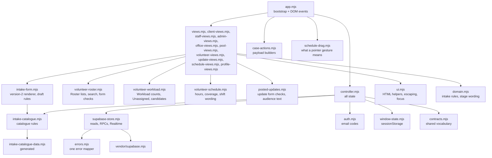

# Front end

The browser app is plain JavaScript ES modules with no framework, no bundler and no build step.
`index.html` loads [`src/app.mjs`](../../src/app.mjs) as a module, and the browser fetches the rest
of `src/` directly. The only third-party code is the Supabase SDK, committed as a pinned bundle in
[`src/vendor/supabase.mjs`](../../src/vendor/supabase.mjs).

The front end **predicts** what a person may do so it can show the right buttons, but the
[database](database.md#the-action-api) decides. Never move a rule into the browser alone.

## Contents

- [Module map](#module-map)
- [Boot sequence](#boot-sequence)
- [The controller](#the-controller)
- [Screens](#screens)
- [Rendering](#rendering)
- [The version-2 intake form](#the-version-2-intake-form)
- [Staff views and Add a case (version 2)](#staff-views-and-add-a-case-version-2)
- [The shaded section of the 13614-C](#the-shaded-section-of-the-13614-c)
- [The Exit Form](#the-exit-form)
- [Stages and their words](#stages-and-their-words)
- [Events and actions](#events-and-actions)
- [Errors, conflicts and retries](#errors-conflicts-and-retries)
- [Feedback](#feedback)
- [Live updates](#live-updates)
- [The contact log](#the-contact-log)
- [Case labels](#case-labels)
- [Clearance uploads](#clearance-uploads)
- [Removing a volunteer from the Roster](#removing-a-volunteer-from-the-roster)
- [Posted updates](#posted-updates)
- [The Schedule and My profile](#the-schedule-and-my-profile)
- [Sign-in](#sign-in)
- [Window state](#window-state)
- [Client languages](#client-languages)
- [Styling and accessibility](#styling-and-accessibility)
- [Testing](#testing)
- [Recipes](#recipes)
- [Moving to a framework](#moving-to-a-framework)

## Module map



Dependency rules that keep the pieces testable:

- **Views are pure.** They take state and return an HTML string. They never import the controller,
  the store or the SDK, and never touch the DOM.
- **The controller renders nothing.** It owns state and calls an injected `render()`. It receives
  `store` and `auth` as arguments, so tests run it against doubles.
- **Only the store talks to Supabase.** Only `app.mjs` imports the SDK, and only to create the
  client it hands to the store and auth modules.
- **`app.mjs` holds no state and writes no HTML.** It reads configuration, builds the modules, and
  turns DOM events into controller calls.
- **Catalogue rules live in one place.** Whether a question is visible, answered, valid or
  missing comes only from [`intake-catalogue.mjs`](../../src/intake-catalogue.mjs); the renderer
  and the draft rules come only from [`intake-form.mjs`](../../src/intake-form.mjs). Screens and
  the controller call them and never re-implement them. The database mirrors the same checks, and
  a test compares the two.

## Boot sequence

1. `app.mjs` fetches `./public-config.json` (relative, so it works under a GitHub Pages subpath).
2. If the file is missing or says `{"configured": false}`, it renders the "ViTally is not configured
   yet" screen and stops before loading the SDK.
3. Otherwise it imports the SDK bundle and creates the Supabase client with the URL and
   publishable key from the config.
4. It creates `auth` ([`auth.mjs`](../../src/auth.mjs)), `store`
   ([`supabase-store.mjs`](../../src/supabase-store.mjs)) and the controller, passing `render`,
   `window.sessionStorage` and `window` (for online/focus events) and `document` (for `visibilitychange`, which wakes a hidden tab
   when it becomes visible).
5. The controller restores the session, reads the membership, loads the right data, subscribes
   to Realtime, and renders.

## The controller

[`src/controller.mjs`](../../src/controller.mjs) is the single source of browser state. The main
fields:

| Field | Meaning |
| --- | --- |
| `session`, `principal` | Sign-in status (`unknown`, `none`, `present`) and `{userId, workspaceId, access, email, personId, personName}`. `access` is `applicant` or `staff`; `personId` and `personName` are a staff account's own roster person, null for an applicant |
| `connection` | `online`, `reconnecting`, `offline` |
| `cases`, `people`, `assistance`, `workspace` | Lists for the current screen (people, assistance and workspace for staff windows only) |
| `savedCase` | The open case exactly as the server last returned it |
| `draftAnswers`, `dirty`, `editBaseRevision`, `conflict`, `saveState` | The intake form's unsaved edits, kept apart from `savedCase` |
| `formSubstep`, `visitedSubsteps`, `returnToSummary`, `revealed` | The sub-step on screen; the sub-steps left at least once, plus `review.submit` once Continue on 9.2 has earned it (stored on the server as `cases.intake_visited`, so their marks follow the client); whether a summary Change is open; and the ids whose invalid value is shown ([below](#the-version-2-intake-form)) |
| `screen`, `selectedCaseId`, `openPanels`, `boardFilters`, `caseTab`, `sidebarOpen` | Window-local navigation, remembered per window |
| `boardSearchDraft` | The work board's half-typed search, kept so a redraw doesn't blank it |
| `busy`, `error`, `retryable`, `notice`, `dialog` | What the page should show right now |

Its public API is the list at the end of the file: `start`, `stop`, `getState`, `refresh`,
sign-in (`sendCode`, `verifyCode`, `editAuthEmail`, `editAuthCode`, `restartSignIn`, `signOut`,
`cooldownRemaining`), cases (`selectCase`, `createCase`, `editAnswers`, `saveAnswers`,
`reconcileAnswers`, `runAction`, `retryLast`), the intake form (`currentSubstep`, `goToSubstep`,
`moveSubstep`, `openForChange`, `backToSummary`, `setRailExpanded`, `setSummaryShut`,
`revealInvalid`, `guardSubmit`, `removeMember`), document cards (`setDocumentCard`,
`setDocumentGroup`), the office's Add a case (`openAddCase`, `toggleAddSubstep`,
`saveOfficeDraft`), assistance (`runAssistanceAction`), language (`setLanguage`, `adoptLanguage`), and navigation
(`navigate`, `togglePanel`, `setBoardFilter`, `clearBoardFilters`,
`setBoardSearchDraft`, `toggleSidebar`, `setCaseTab`, `setLookup`, `openDialog`, `closeDialog`,
`dismissError`, `clearError`).

**`staffWindow()`** is everything a staff screen does (its reads, its eligibility rules and its
actions), true only for a `staff` account (`isStaffWindow` in [`src/contracts.mjs`](../../src/contracts.mjs)
says the same for the views). The person acting is always the account's own `principal.personId`; a
client sends none. None of the thirty-nine RPCs takes the acting person, so the browser never claims an identity (`vitally_save_volunteer` takes a volunteer's person id, but as the record to change, not as who is acting); the
database resolves it ([Database: who is acting](database.md#who-is-acting)). An account with any
other access (a former presenter) gets the "This account has no access" screen and nothing is
loaded for it.

Three rules the controller keeps:

1. **Saved and draft are different.** A live update replaces `savedCase` but never rewrites what
   someone typed. If the server's version changed under unsaved edits, `conflict` is set and saving
   is refused until the person chooses mine or theirs (`reconcileAnswers`).
2. **An unknown outcome keeps its envelope.** On `OFFLINE` or `SERVER_ERROR` the exact envelope is
   kept, and "Try again" (`retryLast`) resends it unchanged so the database replays its receipt
   instead of acting twice.
3. **Answers are whitelisted once** (`pickAnswers`): only the catalogue's top-level ids are kept,
   with their structured values (a `null` means "clear this field on the next save").

## Screens

`app.mjs` picks the screen from state (`screenFor`):

| Who | Screens |
| --- | --- |
| Signed out | Email and code form ([`client-views.mjs`](../../src/client-views.mjs) `accessScreen`); "cannot reach the server" and "no access" screens ([`views.mjs`](../../src/views.mjs)) |
| Applicant | `applications` (list and lookup by Application ID), `reference` (new ID to keep), `intake` (the sub-step form, built by `src/intake-views.mjs`), `progress` (status, client number, requests, send document) |
| Staff window, Cases side (a volunteer account, or a person with both sides who chose Cases) | `staff`: the work board; `staff-case`: the case page with its tabs ([`staff-views.mjs`](../../src/staff-views.mjs)) |
| Staff window, Office side (`admin`, `followup`, `assist` or `receive_documents`, and the side chosen if the person has both) | `staff`: the Follow-ups queue ([`office-views.mjs`](../../src/office-views.mjs)); `office-cases`: the case pool ([`pool-views.mjs`](../../src/pool-views.mjs)); `office-add-case`: Add a case for a walk-in client ([`office-views.mjs`](../../src/office-views.mjs)); `staff-case`: the office's case page ([`admin-views.mjs`](../../src/admin-views.mjs)); `office-volunteers`: the Volunteers Roster and its Add / Edit drawer ([`volunteer-views.mjs`](../../src/volunteer-views.mjs), rules in [`volunteer-roster.mjs`](../../src/volunteer-roster.mjs)); the same page's **Workload** tab for cleared admins, with the Unassigned lists, tagged rows for anyone holding a case without the role, and the Assign / Reassign drawer, which sends `ASSIGN_CASE` with the revision and holder it was opened on ([`workload-views.mjs`](../../src/workload-views.mjs), counts and candidates in [`volunteer-workload.mjs`](../../src/volunteer-workload.mjs)). The Workload is built from the staff case list, `volunteers` and `people` already in the window, so it adds no table or subscription; its tab, sort, search and open rows are window-local and never saved; `office-updates`: Post an update ([`update-views.mjs`](../../src/update-views.mjs)), for a workspace admin only (a site coordinator, or the Admin role this season), cleared or not; `office-settings`: Season settings ([`season-settings-views.mjs`](../../src/season-settings-views.mjs)), for the same admins, with the current season's links and SIDN and the **Next season** card, whose Start next season… dialog (site coordinators only) asks for the next year typed and lists what to finish first when `vitally_start_next_season` refuses ([Start next season](database.md#start-next-season)) |
| Staff window, schedule viewer (a workspace admin, or anyone on the roster with an active account; cleared or not) | `schedule` ([below](#the-schedule-and-my-profile)), in the sidebar as Schedule. My profile (`my-profile`, main's) is a cleared window's, opened from the sidebar account row; its "Your shifts this week" is described below |
| Staff account | The staff screens: the sidebar and the case page header say "Signed in as <name>", and the person is the account's own (`staffScreen` in `views.mjs` picks the Office or Cases side from `workspaceSide` in `contracts.mjs`: a person with only one side's capabilities gets that side, and one with both gets the side they last chose, Office by default). Always English |

**Fill tools.** They follow the demo-tools switch. Three controls exist: the staff "Auto-fill fictional data" button, the client intake's fiction toolbar and the office's Add a case "Fill fictional details" pill. With the switch on, an "Auto-fill fictional data" button appears at the top of each questionnaire, the review-contact form and the filing dialogs (Mark ready to e-file, Mark e-filed, Record filing result, Return to signing). [`src/demo-fill.mjs`](../../src/demo-fill.mjs) fills the form with fictional values that the form's own payload builder accepts. It never overwrites typed text or a defaulted choice, and it sends nothing: the form's own button still submits. `demoFillButton(enabled)` renders nothing when the switch (`state.demoTools`) is off, and the `demo-fill` handler in `app.mjs` checks `demoToolsOn` again. The switch is on only when `/public-config.json` sends `demoTools: true` (`server.mjs` does so only with `VITALLY_DEMO_TOOLS=1` and a loopback `SUPABASE_URL`) and the config's `supabaseUrl` is loopback. When on, these controls show to whoever is on that screen; when off, to no one

`staffScreen` in [`views.mjs`](../../src/views.mjs) wraps staff screens in the app shell
(sidebar plus corner toggle). The collapsed sidebar peeks over the page, without pushing it,
while a mouse rests on the toggle, and closes 300 ms after the pointer leaves the toggle and the
sidebar, unless keyboard focus is in the sidebar or a dialog is open (focus on the toggle never
holds it); a click pins it. [`src/sidebar-peek.mjs`](../../src/sidebar-peek.mjs)
decides, and `app.mjs` applies the peek in place after every render, so a realtime redraw keeps
it. A person with both sides gets an Office / Cases switch (`role="group"`, label "Workspace",
buttons `set-workspace-side` with `aria-pressed`) at the top of the cleared sidebar; `setWorkspaceSide` in
the controller keeps the open case (on its Overview tab), sends the Office-only pages to the work board,
and writes the side to `localStorage` per user (`vitally.workspace-side:<userId>`, in
[`workspace-side.mjs`](../../src/workspace-side.mjs), kept through sign-out). The Office side's
All cases and Workload stay tied to `admin`. An Intaker (no `admin`) has the office with no
switch: Follow-ups lists only help requests and documents to receive, with no Add a case. An office
case page says when the person could claim or work the case on the Cases side, with a Switch to
Cases button. An office screen chosen while the Cases side is showing shows the work board instead. A version-2 case's page reads its answers by sub-step, with the contact,
materials and document-checklist cards, and Add a case follows the workspace's version
([below](#staff-views-and-add-a-case-version-2)).

## Rendering

Every state change calls `render()`, which rebuilds the whole page:

```js
root.innerHTML = views.page(state, screenFor(state));
```

This is simple and makes every screen a pure function, but a full rebuild destroys the element
that had keyboard focus and any text typed into fields that are not in state. Four mechanisms
compensate, all in `app.mjs` and [`ui.mjs`](../../src/ui.mjs):

- **Focus restore.** Before rebuilding, `describeFocus` records the focused element's id, name,
  action and related row ids; afterwards `restoreField` finds the same control again. A control
  whose row disappeared gets no focus rather than another row's button.
- **Staff form drafts.** Text typed in staff forms (reasons, notes, findings) is kept in a
  `formDrafts` map by field id and put back after each rebuild. It is cleared only for the form
  that was submitted. An unsent tick in a staff form's checkboxes (materials, the best time, the
  close-case confirmation) is kept the same way, as `{ checked }`; see `checkDrafts` and
  `restoreDraft` in [`form-values.mjs`](../../src/form-values.mjs). Ticks are also dropped when
  their form is put away unsent (the best time's Cancel, or a dialog closing). Boxes drawn from
  state (toggles with their own action, the "I have checked" box, answer forms) are not kept.
- **In-place patches.** The sign-in countdown and the intake save indicator update their text
  without a rebuild, so they never interrupt typing.
- **Dialogs** take focus when they open and return it to the control that opened them. Tab stays
  inside, also from the dialog itself, and Escape closes. While one is open, every child of `#app`
  is `inert` except the dialog and the live regions (connection notice and problem
  banner); the toast sits outside `#app`. Every confirmation's body is built with `confirmBody`
  (`src/ui.mjs`), which takes the confirm control ready-made, so the dialog keeps its own action
  and payload.

**Version-2 forms have stricter rules**, because a client can type while another window changes
the same case; they are described in [the next section](#the-version-2-intake-form).

**Escape everything.** Views build HTML strings, so every interpolated value must go through
`esc()` from `ui.mjs`. The helpers (`input`, `textarea`, `select`, `button`, `caseButton`) escape
for you; raw template literals do not.

## The version-2 intake form

The form (part 4b, redesigned in part 4b2 as steps 0–9 with sub-steps on a rail tree, a Documents step and Review & submit) is built from the catalogue by the shared renderer in
[`src/intake-form.mjs`](../../src/intake-form.mjs) and the screens in [`src/intake-views.mjs`](../../src/intake-views.mjs); document cards come from [`src/document-cards.mjs`](../../src/document-cards.mjs) and the drafts from `src/draft-form.mjs`, `src/draft-pdf.mjs` and `src/draft-virtual-consent.mjs`. The client's summary page (9.2, `summaryBody`) offers Print and the draft Form 14446 only (`draft14446Buttons`); a client never opens the 13614-C, because its shaded parts are for a certified volunteer. The full design is in [the intake screens spec](../superpowers/specs/2026-09-30-intake-screens-design.md)
§2 (renderer, redraw rules, invalid values) and [the redesign spec](../superpowers/specs/2026-10-04-intake-redesign-design.md); this section is the map.

**The renderer** is pure. `renderQuestion(question, value, { variant, lang, scope, answers,
showMissing, revealed })` returns one question's HTML. Ids are `field-<scope>-<id>` (household
sub-fields `field-<scope>-hh-<n>-<sub>`), so the same question can appear twice on a page. Every
control carries `data-q` (and `data-member`, `data-sub`, `data-date-part` where they apply) and
`data-control`; every question has a fixed note container `field-<scope>-<id>-note` that is
always rendered, so its text can change in place. `readField` and `readForm` read controls back
into answers, `formatAnswer` gives the read-only text ("Apr 12, 1961", "(215) 555-0199").

**The draft holds exactly what is in the box.** Nothing is trimmed while typing. Every check uses
the value as the server would receive it (`sendable`: trimmed text, empty household sub-fields
dropped).

- **Invalid values never reach the server.** One invalid value would make the server refuse the
  whole save, so every save sends `withholdInvalid(draft, 2)`: the draft minus any field whose
  value fails `checkValue`. The draft keeps it, and the server keeps its last valid value.
- **`dirty` means "a save would change the server"** (`sendableDiffers`), recomputed after every
  edit. Editing a withheld value or adding a trailing space leaves it false; an undo turns it
  false again, but only from Unsaved (after a failed save it stays true until a save succeeds).
- **A refresh keeps local-only differences** (`keepLocalOnly`): a withheld value, or one that
  differs from the server's only by spaces, survives a post-save or realtime refresh.
- **Errors are shown only once revealed.** An invalid value's message shows when its id is in
  `revealed`: on `change` (a date only when its step is left) and for every invalid answer when
  the person leaves a sub-step. Typing never reveals; it only clears. Missing answers show "Needs an
  answer" once a sub-step has been visited (`visitedSubsteps`). The Saved chip counts shown errors only;
  Review's alerts and the Submit gate count every visible invalid answer.
- **The review gate** (openspec change `gate-review-and-redesign-summary`):
  - `reviewAlerts(answers)` is every missing and invalid answer. 9.1 lists them, and while there
    is one, 9.1's Continue is disabled.
  - 9.2 is visible only with no alerts. 9.3 is visible only with no alerts and once
    `review.submit` is among the visits, which only Continue on 9.2 adds (`moveSubstep`).
  - `visibleSubsteps`, `resolveSubstep` and `adjacentSubstep` take the visits, so a gated place
    resolves to 9.1.
  - The summary's sections fold through `openPanels` names `summary-shut:<step id>`
    (`setSummaryShut` for Expand and Collapse all), and print open.
  - Submit's guard is `guardSubmit()`: a press on a page drawn before an alert came back reveals
    the invalid answers and goes to 9.1, and nothing is submitted.
- **The four contact fields** (`tp_phone`, `sp_phone`, `best_contact_time`, `best_contact_note`)
  sit in the draft beside the answers (`CONTACT_FIELDS`); the server stores them in
  `case_contacts`. Missing answers are computed from the draft alone.
- A required question counts only while it is shown: the Form 15080 signatures are required once
  the client consents, and the spouse's only when married.
- Some text depends on marital status: a question's `wordingUnmarried`, a sub-step's
  `leadUnmarried` and a section's `introUnmarried` replace the usual text when
  `spouseShown(answers)` is false (the rule that offers "My spouse"). `wording()`, `leadOf()` and
  `introOf()` take the application's `answers`; without them they return the usual text.
- For a client who isn't married, a "who" question (Me / My spouse / No one) renders as Yes/No
  radio buttons: `me` reads Yes and `none` reads No, with the yes/no labels, and the saved answer is
  still a list (`["me"]`/`["none"]`). `valuesFromControls` wraps the radio's value; `formatAnswer`
  labels it Yes/No only when given the application's `answers`.
- **A recently widowed client's spouse** (openspec change `add-widowed-spouse-rules`): `spouseOnReturn(answers)` (rule `spouse_on_return`) asks the late spouse's name and date of birth; `spouseShown(answers)` (rule `joint_possible`, a 2025 death or married) also asks the job title and race, offers "My spouse", picks the married wording, gives the spouse's cards, and prints the draft 13614-C's spouse lines. `substepTitleOf` gives a widowed client the title "Your late spouse" / 已故配偶. The controller drops "spouse" from the who answers once a change of marital status, or a whole valid death year, ends the joint return; a half-typed year, or a move that re-sends an unchanged status, keeps it.
- **A client's service languages** (openspec change `allow-multiple-service-languages`): Q0.3
  `language` is the preferred one; Q0.5 `language_also` adds the others (Q0.6 `language_also_other`
  for Other). `clientLanguages(answers)` in `intake-catalogue.mjs` lists them, preferred first,
  never twice; the work board, case pool and Follow-ups show them as letters through `languageCell`
  (`ui.mjs`), with the names on hover and for screen readers, and their language filters match any
  of them (`speaksLanguage`). The progress page lists the full names.
- **Form 14446** (openspec change `add-form-14446-consent`): 0.4 `before.virtual` asks the virtual-process consent (`vc_agree`, a required one-option checkbox). Until it is ticked, `resolveSubstep` (`intake-form.mjs`, `consented`) sends every place after "Before you start" back to 0.4, the rail shows those steps locked, and Continue is disabled. Add a case is never locked. 1.5 `about.sign` shows the details the form prints, then asks `vc_review` and the signatures; the controller fills `vc_tp_date`/`vc_sp_date` with today on a first signature. "View Draft Form 14446" (`draft-virtual-consent.mjs`) fills page 3 of PCDC's own form, XFA-stripped by `tools/strip-xfa.mjs`, in English and 繁體; `server.mjs` serves the two 14446 PDFs by name.

**Redraw rules** (in `app.mjs`). The page is still rebuilt with `innerHTML`, so the form limits
when that may happen:

1. **A press never loses its target.** While a pointer is down on the page, every redraw, and
   every in-place update caused by `change`, waits until after the `click` (released by
   `pointerup`, `pointercancel`, `contextmenu`, `blur`, `visibilitychange` or a 2-second timer).
2. **`input` updates in place, never redraws:** the question's note, the current step's rail
   mark, a long text's character count and the Saved chip, by `className` and `textContent`
   only.
3. **A full redraw happens only when the visible questions change:** a radio, checkbox or select
   changes, or a text field that drives a show-if (today only `gcf_sp_signature`) changes and the
   `data-q` set on the page differs from `visibleIds(step, draft)` (`needsRedraw`).
4. **Other redraws keep focus, caret and scroll** when they stay in the same place (the same
   screen, case and step, compared inside `render()`). A selected range comes back as a range,
   with its direction (`describeFocus` in `ui.mjs`, `restoreField` in `app.mjs`). If only its
   start came back, text typed over a selection right after a redraw would go in front of the old
   value instead of replacing it (#120, "Otherwindow CityPhiladelphia"). A step change scrolls to
   the top and focuses `#main`. A redraw during IME composition waits for `compositionend`, on
   every page, not only this form (`src/redraw-hold.mjs`, which also holds a redraw during a
   press, #186).

Before a save or a step change, `sweepV2Form` reads the whole form into the draft once more (for
values that arrived without an `input` event, such as autofill); it is skipped while a redraw is
held, because the boxes may then show an older value than the draft.

## Staff views and Add a case (version 2)

Part 4c's staff side. Every rule comes from the shared modules (`intake-catalogue.mjs`,
`intake-form.mjs`, `document-cards.mjs`); nothing here re-implements one.

**The case page's Intake answers tab** (`intakeAnswersTab` in `staff-views.mjs`, shared by the
volunteer and office pages):

- `answersPanelV2`: "What the client told us" by step (`<h3>`) and sub-step (`<h4>`), only the
  visible questions, a required unanswered one as "Not answered", "Wording used: Standard" or
  "Senior", and every "Not sure" answer flagged with an icon and the words, then counted.
- **Contact details (D5).** Shown only when `canSeeContact(record, person)`: the office on any
  case, a volunteer once they are the case's preparer or reviewer. Otherwise the card says only
  "Contact details are shown to the office, and to the preparer and reviewer once the case is
  claimed." and the contact questions are left out of the answers. Staff edit the best time and
  the note ("Edit best time", UPDATE_CONTACT), never a phone.
- **Materials received** (D9): the eleven `MATERIALS_ITEMS`, saved with RECORD_MATERIALS by
  anyone who passes `canSeeContact`, read-only for everyone else.
- **The draft** buttons (`draftTools` in `src/staff-views.mjs`: the 13614-C in three languages and the Form 14446 in two, after the claim), only for people who pass
  `canSeeContact`, because the draft prints the phones. `viewDraft` (`app.mjs`) makes a 13614-C only for a staff window (`isStaffWindow`: a staff account); for anyone else it returns before any tab opens, with no tab, link or error. `writeTab(tab, text, kind)` titles the tab by form: `draft.tab_title` ("Draft 13614-C"), `draft14446.tab_title` ("Draft Form 14446"), or "Exit Form" for `kind: "exit-form"` (staff only, so English), which both the Exit Form's preparing and failed tabs pass (#122).

The contact and materials forms read multi-value checkboxes with `formValuesWithLists`
(`src/form-values.mjs`); `Object.fromEntries(new FormData(form))` would keep only the last box.

**The Documents tab** starts with the client's document checklist (`documentChecklist`): every
card `cardsFor` gives, grouped like the client's Documents step, in the office's words ("Later",
"Don't have", "Mark as not done"; "Asked by: <question>"). Staff who work on the case (018) mark
cards (SET_DOCUMENT_CARD) and move a Maybe card to Needed or back (SET_DOCUMENT_GROUP, shown as
"Needed (moved up by the office)"). The optional "other" card has no marks.

**The questionnaires** (`preparerForm` and `reviewerForm` in `staff-views.mjs`; the payload
builders `preparerQuestionnaire`, `reviewerQuestionnaire` and `exitFormFrom` in
[`src/questionnaires.mjs`](../../src/questionnaires.mjs); what they ask is in the
`review-and-corrections` spec). Parts that depend on an earlier answer are shown and hidden by
CSS alone, with `:has()` on the checked radio, so a redraw never loses them: `q-when-yes` (after
going over the return) and `q-when-in-person` (the signing appointment). The reviewer's Exit Form
has one collapsible group each for Federal, State and every Local type (`exitGroup`), reopened
after a redraw when the volunteer typed in it (`groupsToOpen`), and emptied in place by "Clear
this section". Inside a group, Method and Result come first, and only what that Result needs
follows (#108): `q-exit-when-amount` and `q-exit-when-refund` for Refund, `q-exit-when-amount` and
`q-exit-when-owe` for Owe, `q-exit-when-debit` only for Owe paid by Direct debit, nothing for
None. Hiding never clears a field: `group()` in `questionnaires.mjs` reads only the fields the
Result uses, so a value left in a hidden field is never sent.

**Add a case** is `renderAddCaseV2` in `office-views.mjs`:

- One accordion per visible question sub-step under its step's heading, plus one Documents
  accordion with the office's cards. `review` sub-steps are not on the page; its bottom bar
  sends. The first open part is `before.ready`. Fields are `field-office-<id>`.
- A new office draft has no case (`officeDraft`, no `savedCase`): `saveOfficeDraft()` creates an
  empty case on the first Save draft, adopts it in place and saves into it, and never creates a
  second. Until then the materials card and the document marks are off ("Save the draft first…").
  The office never sends visits.
- The bottom bar counts parts ("n parts still need answers", "Every part is answered"). "Send to
  the office" is off only until `#field-confirmed` is ticked (and while saving). A press with
  missing or invalid answers saves the draft and is refused: "Needs an answer" shows, every part
  that counts opens, and the keyboard goes to the count.
- Leaving with unsaved answers (Cancel, the breadcrumb's Work board, "Back to Follow-ups", or
  the sidebar's Work board and All cases) asks "Leave without saving?" first; Sign out leaves
  without asking. The guard also covers `open-add-case`, though that button
  isn't shown on the page. A conflict with another window shows the shared reconcile choice.
- The same redraw rules as the client's form bind `#add-case-v2-form`.

## The shaded section of the 13614-C

The shaded part of Form 13614-C ("To be completed by certified volunteer") is filled by the case's
preparer, either on the form in the browser or in a PDF program. Four modules carry it; the
database side is in [Database](database.md#the-shaded-section-of-the-13614-c).

**[`src/shaded-fields.mjs`](../../src/shaded-fields.mjs)** is the explicit table of the 106 fields
(`SHADED_FIELDS`): each has a stable `key`, its PDF field name in the English form (`en`) and in
the two Chinese forms (`zh`, shared by 简体 and 繁體; the energy-improvement field is the one name
that differs), a `kind` (`box`, `count`, `amount`, `cell`, `vin`, `year`, `reason`, `note`), a
`label` and a `block`. It is pure (no DOM, no PDF library) and has no wording in it.

- `checkShaded(values, { householdSize, season })` applies the rules and returns
  `[{ key, label, message }]`: a count is 0–99, an amount has at most six digits and two decimals,
  a year is four digits from 2000 to before the season, a reason is at most 120 characters and a
  note at most 500, the Yes/No box pairs (`SHADED_PAIRS`) cannot both be ticked, and a household
  row past the visible count must be blank.
- `readShaded(raw, { form, householdSize, season })` maps `{ pdfFieldName: value }` to
  `{ values, errors }`: a blank is absent, a checkbox is `true`, a household cell is
  `yes`, `no` or `na`. The same table serves the draft fill, the editing copy, the upload and the
  editor. The database repeats the keys and the shape rules; the browser checks first and names
  the field it refuses, and the database stays the authority.
- `householdRows(answers, { version })` is the number of visible household rows: the `hh`
  members, capped at 4, while the catalogue shows `hh` for the case's `intakeVersion`
  (has_household_members is Yes), else 0. Cells on rows past it stay stored but are never shown,
  printed or counted. `visibleShaded(values, answers, { version })` drops them, and
  `shadedCaseRules(record, workspace)` gives `readShaded` the `householdSize` (the same count)
  and the season.

**The draft fill.** `draftFields(answers, { …, shaded })` in
[`src/draft-form.mjs`](../../src/draft-form.mjs) puts the saved values on the form: boxes are
ticked, other values are printed (`shadedPrint`), and the notes come back as
`notes: [{ name, text, block, page }]` for the builder instead of going into `text`. The draft, the editing copy
and the case page's count all read the values through `visibleShaded`. When a visible value
prints, `preparerEntries` is true and the stamp reads "DRAFT – online answers and preparer
entries" instead of "DRAFT – prepared from online answers". All three languages of the 13614-C
print the saved section (the 14446 has none and ignores it). `buildDraftPdf` in
[`src/draft-pdf.mjs`](../../src/draft-pdf.mjs) wraps each note in its own box with the wrapping of
Additional Comments; what does not fit goes ahead of the comments under "Continued from page
<n>, <block> notes:" and then onto continued pages like any comment.

**The editing copy.** `buildEditingCopy({ PDFLib, fontkit, formBytes, fontFiles, fields, shaded,
reference, version })` is the same build with `editing` set:

- A partial flatten (`partialFlatten`, a copy of pdf-lib 1.17.1's `flatten` that skips named
  fields) draws every field's appearance on its page and removes it, except the 106 shaded fields,
  which stay live and hold the stored values. The client's answers are therefore fixed text and
  only the shaded section can be typed in.
- Text that WinAnsi cannot draw (Chinese, for example) is set as the field's `/V` with no
  appearance, and `NeedAppearances` is set so the viewer makes it.
- The PDF's Keywords carry `vitally-shaded case:<reference> version:<n>`, which is how an upload
  is matched to its case and to the version it was made from. The copy is English only and is
  never uploaded to a server or stored.

**Download and upload** (`shadedPanel` in `src/staff-views.mjs`, on the Intake answers tab for
both the volunteer and office pages; handlers in `src/app.mjs`):

- The panel shows "Fill the shaded section" (the editor), "Download to fill elsewhere" and "Upload
  the filled copy", only when `staffEligibility(...).shadedSection` allows it (the case's
  preparer, while the case is being prepared or corrections are requested); otherwise it says why
  not. It also lists the browsers the editor works in: Chrome and Edge 125 or later, Firefox ESR
  or later, Safari 18 or later. In any other browser, download and upload still work.
- The three handlers in `app.mjs` (`openEditor`, `downloadShadedCopy`, `uploadShadedCopy`) and
  `editorGone` run for any staff window (`isStaffWindow`: a staff account), the
  rule every other staff screen uses (#103). Who may fill is still `staffEligibility` alone,
  which for a staff account reads the account's own person. The browser story downloads,
  uploads and fills the section in the editor as staff accounts (the Preparer, Taylor Brooks, in
  the main story, and Riley Park), and checks that a field is as tall as its cell.
- `downloadShadedCopy` builds the editing copy and saves it as `13614-C-shaded-<reference>.pdf`.
- Beside the Download button the panel says to open the copy in Chrome or the free Adobe Acrobat
  Reader, not macOS Preview (`.shaded-download-note`).
- `uploadShadedCopy` reads the file with `readFilledCopy({ PDFLib, bytes, reference })`, which
  returns `{ raw, version, preview }` or throws an error with a `code` and a sentence for the
  preparer: `NOT_A_PDF` (not a readable PDF), `NO_FIELDS` (none of the shaded fields: a printed
  copy, so it says to use the download button, not Print) or `OTHER_CASE` (the Keywords name
  another case). The file is loaded with `updateMetadata: false`, so the Producer is the one the
  copy was saved with, and `preview` is true when it names macOS Preview (which can drop filled
  values). The values then go through `readShaded` with the case's household size and season. If
  none are filled, the upload is refused after the other refusals, with the no-values message
  (which adds a Preview note when `preview` is set).
- Otherwise nothing is saved yet. The values are held in `state.shadedReview` (per case) and the
  panel replaces the upload control with "Check what was read from this copy": a count, one row
  per filled field, a Preview warning when `preview` is set, and "Save these values"
  (`confirm-shaded-review`, which calls `controller.confirmShadedReview()`; that re-checks the case, then calls
  `saveShadedSection(values, version)`, and focus returns to the upload control) or
  "Cancel" (`cancel-shaded-review`). The held review is dropped on a case switch, on sign-out and
  when a new file is uploaded. A refusal or a failed save is shown in the panel, beside the control
  (`SHADED_UPLOAD`), and "Saved" is shown there on success, so nothing is lost behind a refusal. A
  `CONFLICT` there means the section was saved since the copy was downloaded, and the sentence says
  to download a fresh copy.
- The case's History tab lists a save as "saved the shaded section", followed by the labels of the
  fields that changed (never their values). A client sees nothing: no client event is written.

**The editor** ([`src/shaded-editor.mjs`](../../src/shaded-editor.mjs)) draws the editing copy
with pdf.js in a full-screen layer, so the preparer types straight onto the form.

- **Why the layer lives beside `#app`, not in it.** `render()` replaces the whole of `#app` on
  every state change, realtime events included, and would wipe what the preparer had typed and
  the pdf.js canvases. The layer is a sibling that `render()` never touches. While it is open,
  `#app` is `inert` (the layer is a modal dialog with its own focus trap and Escape/Close
  handling), and the page's own key handler in `app.mjs` returns early.
- **Two parts.** `createEditorSession` decides, with no DOM: what changed, when Save is
  available, what a refusal says, and when Close and Escape ask "Discard your changes?" first.
  `openShadedEditor` draws the layer and wires it to a session. pdf.js is passed in (`loadPdfjs`
  in `app.mjs`, a dynamic `import("./vendor/pdfjs.mjs")` with the worker set to
  `./vendor/pdfjs-worker.mjs`), so it loads only when the editor opens. The editor's `ready`
  promise settles once every page is drawn (the story waits for it) and rejects, after the layer
  has gone, when it cannot open; the panel then shows "The editor did not open" with Try again.
- **Saving.** `createShadedSave` is the `onSave` the editor calls. It checks the values with
  `readShaded`, then sends them with `basedOnVersion`; an accepted save made exactly `version + 1`
  (the server writes based + 1), so that is the next base. It is never read back from the case,
  because another window's newer save landing first would be adopted and silently overwritten.
  The server says `CONFLICT` for a stale case revision as well as a stale section. After one, the
  window has re-read the case: if the section is still at this editor's version, only the case
  moved (the office recorded materials, say), and the same values are sent once more, once. If
  the case moved again, Save stays offered without the conflict sentence; if the section itself
  moved, the editor says "Saved elsewhere since you opened this. Close and reopen to see the
  latest." Save keeps the editor open.
- **Leaving.** While there are unsaved changes, `beforeunload` guards the tab. The editor closes
  by itself (`editorGone`, checked in `render()`) when the case is no longer the selected one or
  no staff window is signed in (a staff account), for example after a sign-out in
  another tab, without a prompt.
- **Field size.** pdf.js sizes each annotation input at `height: 100%` of its section, so the
  page's global field rule (padding, `min-height: var(--vt-tap)`, radius) must not reach it: it
  made every input 44px tall and pushed typed values a row down. The editor's own input rule in
  `styles.css` resets padding, min-height, radius and line-height (#103). Keep that reset when
  changing the global field style.
- **Vendor files.** `src/vendor/pdfjs.mjs` and `src/vendor/pdfjs-worker.mjs` are copied from
  `pdfjs-dist`'s legacy build by `buildPdfjsFiles()` in `tools/build.mjs`
  (`npm run build:vendor`), with the library version in a banner. The server's allowlist already
  serves `/src/vendor/<name>.mjs`. The other two vendor files are `supabase.mjs` and `pdf-lib.mjs`
  ([setup](../setup.md#the-vendor-bundle)).

## The Exit Form

The Exit Form is PCDC's one-page bilingual hand-out that the client gets at signing. Staff make it
in the browser from an approval's reviewer questionnaire, and nothing is uploaded or kept.

- **Where it is offered.** "Download Exit Form" appears under each approved review that has a
  reviewer questionnaire, on the volunteer's Independent review panel (`exitFormTool` in
  `staff-views.mjs`). The office's case page has no review panel, so its Overview gets an Exit Form
  panel (`exitFormPanel`) for the latest approved review only, with no fallback to an earlier one; if
  that review has no questionnaire, the panel is not shown.
- **After a Return to signing.** The questionnaire records the return as it stood at approval, so
  `exitFormSource(record, review)` in [`src/exit-form-source.mjs`](../../src/exit-form-source.mjs)
  decides what both places may print. If a `RETURN_TO_SIGNING` entry in the staff history is later
  than the review's `decidedAt` (an approval with no `decidedAt`, or one that can't be parsed,
  counts every Return to signing as later), only the settled methods (a method is set and its result is not
  `rejected`) are ticked, and everything else is blank: amounts, payment methods, debit dates, Other
  Tax and Remarks. `exitFormNote` builds the note that says what to fill in by hand. The note is HTML,
  shown in the office panel and beside the volunteer's "Download Exit Form" button, and only when
  the return was corrected. The PDF itself carries no note, only the blanks. Without staff history,
  no form is offered. Fixed in
  [#173](https://github.com/jin-yu-yang/vitally/issues/173). Still open:
  [#204](https://github.com/jin-yu-yang/vitally/issues/204) (the review-contact
  line after a Return to signing).
- **Corrected values at Return to signing (#203).** The Return to signing dialog
  (`returnToSigningDialogBody` in `admin-views.mjs`) optionally collects the corrected Exit Form
  values: a closed `<details class="q-exit-group">` for each return the case has a method for and
  for each of the five Local types, and Remarks. A settled return shows its method as text with a
  hidden `<prefix>.fixedMethod`; a rejected return has method radios. The payload builder
  (`returnToSigning` in `case-actions.mjs`) sends `exitForm` and `remarks` only when something is
  filled, and refuses a method-only group or a bad amount in the browser (the dialog stays open and
  the typed group stays open). The values go to `return_to_signing_exit_forms`
  ([database](database.md#action-catalogue)), and the event's `detail.exitFormId` names the row.
  `exitFormSource` then prints the stored values: the settled methods come from the case, the rest
  from the row, and the note reads "This form was filled from the corrected values recorded on
  <date>." (the New York date of the event), plus " Fill in by hand: <list>." only for what is
  still missing. With no stored values the #173 note and blank form are unchanged.
- **Mark e-filed after a Return to signing.** Each rejected return's method radios
  (`method-federal`, `method-state`) start with the method planned at Return to signing checked
  (`plannedMethod`), but only when every rejected return has a plan; otherwise nothing is
  preselected. The admin can change it.
- **Who may make it.** `viewExitForm` in `app.mjs` returns at once for anything but a staff window
  (`isStaffWindow`). Like the drafts, it opens a new tab and, if the browser blocks the tab,
  offers a link instead (`draftOffers`). A blocked tab's link is drawn on the Intake answers tab, so
  it can't be seen from Overview, it ends after about 60 seconds, and it doesn't exist for a
  volunteer who can't see the contact details
  ([#122](https://github.com/jin-yu-yang/vitally/issues/122)).
- **What goes on it.** `exitFormMarks(questionnaire, header, today)` in
  [`src/exit-form.mjs`](../../src/exit-form.mjs) decides everything, with no DOM. Its questionnaire comes from `exitFormSource`. `buildExitFormPdf`
  then draws it on the blank template.
  - The header has the tax year (the case's season − 1), today's date, the client number, and the
    taxpayer's name. A couple (married, or widowed in the tax year, by the intake's own spouse
    rule) gets "Taxpayer & Spouse".
  - Federal and State tick e-file or paper and the refund or payment method, then write the
    amount and the direct-debit date.
  - Under Other Tax, the template's boxes are covered by one printed row per Local type, so a blank
    copy can still be filled by hand. The details a row has no room for go to the front of the
    remarks.
  - Filled values are drawn in Helvetica Bold, unless a value has a character Helvetica can't
    draw (Chinese, or a letter like "ễ"), which is then drawn entirely in the downloaded font. The header and the
    amounts are larger than the form's 12 pt labels, the Remarks start at 12 pt, and a debit date
    is drawn at 6.5 pt because its place is small
    ([#122](https://github.com/jin-yu-yang/vitally/issues/122)).
- **The template.** `src/forms/exit-form-pcdc.pdf` (`EXIT_FORM_FILE`) has no form fields, so every
  value goes at a fixed place in `EXIT_FORM_LAYOUT`, measured in points from the page's top-left
  corner. A new version of PCDC's form means measuring those places again. The local server
  serves the file by its exact name (`FORMS` in `server.mjs`), and a static host must publish it
  with the other forms. Strip a new template's document info (author, title) before committing
  it, because a Word export carries the author's name. The generated PDF's author is blank too.
- **Fonts.** The Other Tax rows are bilingual, so every Exit Form fetches the Traditional Chinese
  Noto font, with the drafts' pinned, checked files (`draftFontFiles`). If that fails, no form is
  made ([#122](https://github.com/jin-yu-yang/vitally/issues/122)).
- **Privacy.** Nothing about a bank account is drawn, because none is stored
  (`review-and-corrections`).
- **Tests.** `tests/exit-form-source.test.mjs` pins the source rule and the note. `tests/exit-form.test.mjs` covers the marks, builds real PDFs, and pins long Remarks
  and the template's document info. `tests/shell.test.mjs` pins `viewExitForm`'s wiring. The button
  assertions are in `tests/staff-views.test.mjs` and `tests/admin-views.test.mjs`, and the allowlist
  entry is in `tests/server.test.mjs`. The browser story presses the button, a failure with its
  retry, and a blocked tab, with a Chrome staff window only.

## Stages and their words

A case has one of sixteen stages, in chain order: `draft`, `received`, `screening`,
`awaiting_documents`, `on_hold`, `preparation_ready`, `preparing`, `review_ready`, `reviewing`, `corrections_required`,
`review_approved`, `ready_to_efile`, `efiled`, `rejected`, `accepted`, `closed`. The browser decides
none of the moves (the database does, see the [state machine](database.md#the-case-state-machine));
it only names what it shows. `describeStage(stage, lang, record)` in
[`domain.mjs`](../../src/domain.mjs) is the one place the words live. The `record` (a case) is
needed only for `efiled`, `rejected` and `accepted`, whose words depend on how each return was
filed. For each stage it returns three texts:

| Field | Who reads it | Where it comes from |
| --- | --- | --- |
| `label` | Staff | `STAGE_DESCRIPTIONS`; always English (for example `screening` is "Screening in progress", `review_approved` is "Ready to exit") |
| `clientLabel` | The client | `STAGE_DESCRIPTIONS` in English; the `stage.<stage>.label` key of `TEXT` in the other languages (`received` is "Sent to PCDC", `screening` is "Being reviewed", `review_approved` is "Ready to sign", `ready_to_efile` is "Ready") |
| `clientMessage` | The client | The same, `stage.<stage>.client` |

Two stages are new (036). `awaiting_documents` is "Waiting for documents" for staff and "Documents
needed" for the client; `on_hold` is "Hold" and "Waiting for you". A Hold's client message depends
on where it came from (`holdKind(record)` in `domain.mjs`: `documents` or `signing`), and a closed
case's message depends on `closingReason` (`stage.closed.client.<reason>`); a case closed with no
reason, or with Other, gets the generic message. At Ready to exit, a Hold from Ready to exit, Ready
to e-file and Rejected (`mustContactToWithdraw(record)` in `domain.mjs`), the client reads a
"contact PCDC" line in place of the Withdraw button; E-filed, Accepted and Closed show neither.

A stage that is not in the table gets neutral wording. A client message names no milestone the case
has not reached, and no client text names a phone number.

**Names by filing method.** From the case's `federal_method` and `state_method`:

| Stage | Staff name (both e-filed / PA on paper / federal on paper / both paper) | Client label |
| --- | --- | --- |
| `efiled` | Both e-filed / E-filed, PA on paper / E-filed, federal on paper / (Both paper, not reached now) | E-filed / Filed / Filed / Filed |
| `rejected` | Rejected | Needs a correction |
| `accepted` | Accepted / Accepted, PA on paper / Accepted, federal on paper / Paper | Complete / Ready to mail / Ready to mail / Ready to mail |

A case e-filed before the methods existed (null methods) is "E-filed" for staff and the client.
PCDC never mails a return: a paper return is given to the client at Mark e-filed, so a case with
nothing e-filed waiting goes straight to Accepted, and "Ready to mail" tells the client to sign the
paper return and mail it themselves. A paper return filed under 035 that is still waiting for a
result reads as given to the client too (`returnState`), so such a case still renders.
`filingMessage` composes the client's message: a sentence for each return (one combined sentence
when both returns are in the same state), then the stage's closing sentence. It never names a
reject code or a fix note, which a client session does not receive. A case at `review_approved`
that has methods was returned to signing, and its message asks the client to sign again.

- **The badge.** `stageBadge(stage, lang, { audience })` in [`ui.mjs`](../../src/ui.mjs) shows
  `label` for `audience: "staff"` (the default) and `clientLabel` for `audience: "client"`. The
  client's screens (the applications list, the progress page and its review panel) pass
  `"client"`; every staff and office screen leaves the default.
- **The staff lifecycle bar** (`lifecycleBar` in `staff-views.mjs`) lists ten steps with staff
  labels: `received`, `screening`, `preparation_ready`, `preparing`, `review_ready`, `reviewing`,
  `review_approved`, `ready_to_efile`, `efiled`, `accepted`. Accepted is the end: an accepted case
  shows every step done and none current. A `closed` case gets an eleventh step, Closed, as the
  only current one; the steps before it are `neutral` (neither done nor to come), because nothing
  records the stage a case was closed from, and the History tab shows its path (#109, change
  `fix-lifecycle-bar-closed-after-accepted`). A case in
  `corrections_required` shows on the `preparing` step, marked as an amendment; a `rejected` case
  shows on the `efiled` step the same way. A case at Waiting for documents shows on the step it
  was asked from (`documentsOrigin`), and a Hold on the step it came from (`holdOrigin`), both
  marked like an amendment with their own label.
- **The client's progress track** (`PROGRESS_STEPS` in `client-views.mjs`) has five steps, each
  holding the stages that belong to it: intake (`draft`, `received`, `screening`, and Waiting for
  documents or a documents Hold; a Hold from Ready to exit sits on signing), preparation
  (`preparation_ready`, `preparing`, `corrections_required`), review (`review_ready`, `reviewing`),
  signing (`review_approved`) and filing (`ready_to_efile`, `efiled`, `rejected`). A `rejected`
  case therefore sits on Filing. An `accepted` case shows every step done, with the "done"
  screen-reader text. A `closed` case shows no current step.
- **History lines.** The three lines the database writes for the new actions ("PCDC started
  reviewing your application. We may call you.", the signing line and "PCDC e-filed your
  return.") are entries in `SENTENCES`, so the client reads them in their own language.

### Screening starts when an admin opens the case

An admin opening a `received` case's page starts its screening. `startScreeningIfDue` in
[`controller.mjs`](../../src/controller.mjs) sends `START_SCREENING` (empty payload) when all of
these hold: the open case is at `received`, the screen is `staff-case`, the acting person has
the `admin` capability, and nothing else is busy or pending. It runs after a case is opened
(`selectCase`), after a reload on a case page, after a
refresh or reconnect, and when a busy action ends. Nothing is pressed, so:

- **No refusal is shown.** A race ("another admin got there first", a stale revision) re-reads the
  case, and one retry runs at the new revision. Any other refusal gives up on that case in this
  window until it is opened again.
- **An offline start is held whole** and resent unchanged on the next refresh, so the database
  replays its receipt instead of acting twice.
- **A case action pressed meanwhile waits** for the start (`runAction`), so it carries the revision
  the start leaves behind.

The other two new actions are the office's buttons on a case page, "Mark ready to e-file…" and
"Mark e-filed…" (`admin-views.mjs`). Each opens a confirm dialog with a "this is true" checkbox and
sends its payload through `payloadFor` (`{confirmed: true}` for "Mark ready to e-file…";
`{confirmed, methods}` for "Mark e-filed…"), like any [workflow button](#events-and-actions).
`adminEligibility` (`admin-views.mjs`) allows the first only for an admin on a `review_approved` case
whose reviewer has recorded a completed call with the client (the database checks the same), and
the second only for an admin on a `ready_to_efile` case. The Follow-ups signing and e-filing rows
offer the same two marks, selecting the case in place. While a `go_over_return` follow-up is open,
Follow-ups lists no signing row for the case: its Call the client row stands for it until the task
is resolved or cancelled (#177).

After E-filed, three more admin buttons record the IRS's and Pennsylvania's answers by hand
(nothing is sent to either). "Mark e-filed…" asks how each return was filed with four choices
(both e-filed, federal e-filed and Pennsylvania on paper, the reverse, or both on paper, each paper
choice "given to the client to mail") and sends `{confirmed, methods}`; filing again offers only the
rejected returns and lists the rest as done. "Record filing result…" (`efiled`, or `rejected` while an
e-filed return is waiting) asks for e-filed returns only, never a paper one, and sends each waiting
return's result, date and, when rejected, a code, plus an optional fix note. "Return to signing…" (`rejected`
with every return answered) sends `{confirmed: true}` plus the optional corrected Exit Form values (`exitForm`, `remarks`; see [The Exit Form](#the-exit-form)); "Close case…" is also offered at `rejected`.
A staff-only Filing panel on the case page lists every attempt, newest first, with each return's
method, result, date and code, and the fix notes in the order recorded. The case pool has two more
tabs, Needs attention (`rejected`) and Done (`accepted`), and Follow-ups gains the kinds "Filing
result" and "Rejected".

Hold and closing (036) add admin buttons: "Ask for documents…" (Screening, Pending intake / filing;
one to five requests), "Put on hold…" (Waiting for documents or Ready to exit; an optional staff
note), "Got in touch…" (Hold), and "Close case…" with a reason list (Out of scope, No need to file,
Duplicate, Dismissed, Withdrawn, Other; a note is required for Other), which is also offered at
Waiting for documents and Hold, and at Ready to exit and Ready to e-file with only Withdrawn
selectable (a note in the dialog says why). An admin records and verifies documents at Waiting for documents
and a documents Hold. In the case pool, Waiting for documents sits under Waiting on client, Hold
under Needs attention, and Closed has a reason filter (with "No reason" for older cases).
Follow-ups gains the kinds "Waiting for documents", "Hold" and "Withdrawn" (the
`withdrawal_notice` task, "The client withdrew; tell <name> to stop work.", or, for an admin's
close before filing, "The client withdrew; make sure the return is not transmitted in TaxSlayer."
(reason Withdrawn) or "The case was closed before filing; make sure the return is not transmitted
in TaxSlayer." (any other reason from a signing hold), told apart by the notice's stored text, which the list summary carries as
`withdrawalNoticeReason`). Notes are escaped in
the staff history and never reach a client screen.

On the client's side, the progress page shows a **Withdraw this application** button at the stages
in `WITHDRAW_STAGES` (and on a documents Hold), which opens a dialog with one box to tick and sends
`{confirmed: true}`. It is not shown from Ready to exit on; at the stages in
`mustContactToWithdraw` the client reads the contact line instead.

### The season-end dialog

For an admin, the Follow-ups queue has a **Close unsigned cases…** button (`open-close-unsigned`),
disabled with its reason when no case is waiting for a signature. Its dialog
(`closeUnsignedDialogBody` in `office-views.mjs`) lists every case at Ready to exit or on a Hold from
Ready to exit (`unsignedCases`), oldest first, each ticked with its reference, client name, stage
and days waiting. The heading follows the ticks ("Close 2 of 5 cases that are waiting for a
signature, as Dismissed?"), and **Close as Dismissed** opens only with a case ticked and the "didn't
come back to sign" box ticked. It calls `controller.closeUnsigned(cases)`, which sends one
`vitally_close_unsigned` with each ticked case's id and the revision the dialog showed
([Season-end close](database.md#season-end-close)). On a `CONFLICT` the list is re-read and the dialog
reopens without the case that moved, with nothing closed. On success it closes the dialog and
toasts "The unsigned cases were closed as Dismissed."

## Events and actions

`app.mjs` listens once on the root for `click`, `input`, `change` and `submit` (and on the document
for `keydown`, for Escape and dialog focus), and reads data attributes:

| Attribute | Meaning | Handled by |
| --- | --- | --- |
| `data-action="open-case"` | Navigation or a UI toggle | The `runNavigation` switch in `app.mjs` |
| `data-case-action="VERIFY_DOCUMENT"` | A workflow action | `payloadFor` then `controller.runAction` |
| `data-assistance-action="CLAIM"` | An assistance item action | `controller.runAssistanceAction` |
| `data-case-id`, `data-request-id`, `data-followup-id`, `data-item-id` | Which row the control belongs to | Payload builders and focus restore |

A workflow button inside a `<form class="staff-form">` submits the form; `payloadFor(type,
button.dataset, formValues)` in [`case-actions.mjs`](../../src/case-actions.mjs) builds the payload
and refuses locally anything the database would refuse for certain (unknown type, missing required
text, missing related id). The controller then adds the envelope fields and sends it.

Field ids come from `fieldId(name, scope)`. Any control repeated per row must pass the row id as
`scope` and carry the row's `data-*-id`, so two rows never share an id.

## Errors, conflicts and retries

Every failure reaches the controller as an error with a `code` from `ERROR_CODES`
([`contracts.mjs`](../../src/contracts.mjs)), mapped once in
[`errors.mjs`](../../src/errors.mjs). The page shows a safe sentence for the code, never database
text.

| Code | What the controller does |
| --- | --- |
| `CONFLICT` | Re-reads the case, shows "Someone else changed this ...", drops the envelope |
| `OFFLINE`, `SERVER_ERROR` | Keeps the envelope, shows the problem banner with "Try again" |
| `FORBIDDEN`, `NOT_FOUND`, `INVALID_TRANSITION`, `SELF_REVIEW`, `INELIGIBLE`, `VALIDATION` | Shows the refusal; nothing to retry |

**Eligibility helpers** (`staffEligibility` in `staff-views.mjs`, `adminEligibility` in
`admin-views.mjs`) follow the database's check order so the page can hide unavailable buttons and
explain why ("A different volunteer has to review this case"). They are predictions; the database
answer always wins.

## Feedback

How the page says that something worked, failed, is loading or is busy (change
`unify-feedback-and-loading-states`). The design system's colours for each are in
[`docs/design/DESIGN.md`](../design/DESIGN.md).

**Errors show where the person is looking, one at a time.** An error never toasts. It goes to:

- the problem banner above `#main` (`.problem-banner`, `role="alert"`), with Try again
  (`data-action="retry-action"`) when there is something to retry and Dismiss
  (`data-action="dismiss-error"`);
- in place, beside the failed action, on the staff case page (the banner then stays away);
- inside the open dialog (`dialogError` in `views.mjs`, `#dialog-error`), because an alert behind an
  `aria-modal` dialog could not be reached;
- the save chip, for a failed save.

The controller keeps one `state.error`: a newer error replaces the one before, including a failed
save's (the draft stays and goes with the next move or save). The sign-in screens keep their own
in-form alert.

**`refuse` and `noteLocalFailure` (controller).** `refuse(code, message)` is a refusal the window
makes itself: it records the error, draws it, and only then returns the error for the caller to
throw, so nothing is refused without being shown. `noteLocalFailure(error, retry)` records a
failure outside the store's actions (a draft PDF that could not be built, a missing form). Its
optional `retry` is the one local retry: Try again runs it (`retryLast` answers `{ local: true }`),
and any newer error, Dismiss or sign-out drops it, Try again included. The draft's retry calls
`viewDraft` again before anything is awaited, so the rebuilt draft opens its tab inside the press. A
draft built afterwards clears only the draft's own error (`clearError("DRAFT")`), never a notice. A
press that throws and records nothing goes through `app.mjs`'s safety net, which records "Something
went wrong." (or the known sentence) the same way. It tells the two apart by `errorCount`, which
every recorded error raises.

**The toast** ([`toast.mjs`](../../src/toast.mjs) for the timer, `app.mjs` for the page). It
confirms, informs or warns, and nothing else: `notify(kind, text, by)` with `kind` one of
`"success"`, `"info"` or `"warning"`. `TOAST_MS` keeps a success or information for 5 s and a
warning for 8 s. The pointer over the toast or focus inside it holds it, and the full time starts
again when both leave; Dismiss (a 44 px icon button with a name) or Escape hides it, and a hidden
toast is out of the Tab order with its text cleared after its fade. Its host, `#toast`, is made once by `app.mjs`
right after `#app` and never redrawn: children `.toast-icon-slot`, `.toast-text`
(`role="status"`, `aria-live="polite"`) and `.toast-dismiss`. It sits bottom centre for clients and
bottom right on staff screens (`.toast-staff`), lifted above Add a case's sticky bar while that bar
is on screen. `views.toastParts` gives the icon, text and Dismiss label for a kind.

**Lists say when they are loading or couldn't load.** `state.lists` holds `"loading"`, `"ready"` or
`"failed"` for `cases` and `assistance`. Until a list is ready its screen shows one of two lines
from [`ui.mjs`](../../src/ui.mjs): `loadingLine` (a spinner and a sentence, `role="status"`) or
`unloadedLine` (under the banner's Try again, which reads everything again). A list that loaded once
keeps what it shows when a later read fails. Staff views get it as `ui.list`.

**Empty lists.** A list that has loaded and has nothing to show uses `emptyState` (a panel: icon,
optional heading, one sentence, and the buttons that undo a filter) or `emptyLine` (one muted line
inside a case or a drawer), both from [`ui.mjs`](../../src/ui.mjs). Each list keeps its own words
and passes its own buttons. Both take HTML the caller has already escaped, unlike `loadingLine`
and `unloadedLine`, so a client's own text goes through `esc` first. The work board's sentence per tab lives in `EMPTY_TAB`
(`staff-views.mjs`): a new phase adds its sentence there.

**Busy buttons.** While a press runs, `markPressed` in `app.mjs` gives the pressed control
`.is-busy`, `aria-busy="true"` and a spinner, and finds it again after every redraw. Only presses
that hold the buttons are marked: a workflow or assistance action and the
`BUSY_ACTIONS` allow-list (`save-office-draft`, `send-office-draft`). A
sub-step move is never marked; the save chip says Saving.

**The connection notice and "back online".** `connectionNotice` in `views.mjs` shows while the
channel is reconnecting (with a spinner) or offline. When the connection returns after a real loss,
never on the first connection, the page toasts `toast.back_online` ("You're back online.") as
information.

## Live updates

After sign-in the controller calls `store.subscribe`, which opens one Realtime channel for the
tables the principal may read (`SUBSCRIBED_TABLES`). Each event is reduced to
`{table, eventType, id, caseId}`. `handleChange` in the controller decides what may be stale and
re-reads it:

- a `cases` event: the list;
- a `contact_log` event: the list too, since a new entry moves the case's `lastContactAt` (the
  Workload's Stalled count) without touching the case row;
- any event about the open case (its requests, documents, history, reviews): that case;
- an `assistance_items` event: the assistance list;
- a `workspaces` event (a change to the workspace row, such as its intake
  version): everything, with a notice if the open case vanished;
- a `shifts` or `schedule_settings` event: the Schedule's open day, My profile's "Your shifts this week" (a `shifts` event) and, on Season settings, the site hours card (an uncleared viewer's window follows only these two tables, and only while it is on the Schedule);
- a `posted_updates` event: the Notifications feed, and the admin's table when Post an update is
  open. `update_reads` is not published, so the table re-reads on opening and on focus instead.

`case_contacts`, `case_materials`, `contact_log` and `contact_log_versions` events carry a case id
like the other child tables, so they re-read the open case. That is how a contact logged in one
window shows in another. A contact logged in this window re-reads the list as well as the case
once the write lands; an edit keeps the logged time, so it re-reads only the case.

Connection status (`online`, `reconnecting`, `offline`) comes from the channel and shows in the
page header. On reconnect, window focus and the browser's `online` event, the
controller refreshes.

## Case labels

Staff tag a case with short colored labels (City Tax, MFS, Multi-state, or their own). The database
side is in [Database: case labels](database.md#case-labels). The rules that decide what is shown
live in [`src/case-labels.mjs`](../../src/case-labels.mjs); the database decides what is allowed.

- **`src/case-labels.mjs`** is pure: `LABEL_COLORS`, `canLabelCase(record, person)` (an `admin` or
  `followup` person, or the case's preparer or reviewer, on a case that is not closed),
  `canManageLabels(person)` (`admin`), `sortLabels` and `labelNameTaken` (equal ignoring case).
- **Chips.** `labelChip` in `ui.mjs` draws a label as a colored chip. The case page header
  (`labelRow` in `staff-views.mjs`) shows the case's chips, with a remove button
  ("Remove label <name>") on each for a person who passes `canLabelCase`, and "+ Add a label"
  after them. Anyone else reads the chips and gets no control. The work board and the case pool
  show the chips read-only under the reference.
- **The menu** (`labelMenu`, opened by `open-label-menu`, closed by `close-label-menu` or Escape,
  which returns the keyboard to the button). A search box filters the label rows; each row is a
  `toggle-case-label` button that adds or removes the label. An admin also sees Edit
  (`edit-label`) on each row and, when what was typed matches no label, `Create "<text>"`
  (`create-label`). The form (`labelForm`) has a name field and six color radios; `save-label` reads
  them from the page, a create also puts the new label on the case, and `cancel-label-edit` goes
  back to the list. A name the window can see is taken, a blank name and a name over 24 characters
  are said in the form and nothing is sent.
- **State.** The labels and the open menu (`state.labels`, `state.labelMenu`) are window-local and
  never saved. The labels ride with the case list: `loadList` reads `store.listLabels()` for a
  staff window. The chips on a board or pool row come from `listCases`, which joins
  `case_labels` and the active `case_label_links`. For staff, `listCases` reads only the
  current season's cases plus drafts (no season yet), and `getCase` answers `VT002` for a
  past-season case, as for an absent one (`add-start-next-season` design D7).
- **Writes.** `controller.toggleCaseLabel` and `saveLabelEdit` call the store's
  `setCaseLabel` and `saveLabel`. A write whose answer never came (`UNKNOWN_OUTCOME`) is kept, so
  pressing it again sends the same action id, before the form's own checks: after a create whose
  answer was lost, the re-read list already holds the new label, and that is no reason to refuse it.
  An edit sends the revision the form opened on (`labelMenu.editing.revision`), not the live list's,
  so a rename or recolor made elsewhere meanwhile gets `CONFLICT`. A `CONFLICT` re-reads the labels,
  the form takes the fresh revision and stays open, and the next save is judged against it.
- **The case pool's Label filter** (`pool-views.mjs`, `poolLabel`): a select with Any label, each
  label, and No label. It is one of the filters "Clear filters" clears; a saved value that names a
  label that no longer exists falls back to Any label.
- **History.** The History tab reads "<person> added label <name>" and "<person> removed label
  <name>".

## The contact log

Staff log contacts (calls, texts, emails, visits) from three places that share one form. The
database side is in [Database: the contact log](database.md#the-contact-log).

- **`src/contact-log.mjs`** is pure. It holds the option lists and labels, `outcomesFor(method,
  direction)`, `staffShortName`, and `contactSummary` / `contactSummaries`, which build the
  one-line text the list and both Copy buttons use (so they cannot differ). Every time in the log
  is **America/New_York**: `contactTime` formats an instant, and `nyLocalInput` / `nyLocalToIso`
  convert to and from the `datetime-local` field's New York wall time, including daylight saving.
  `contactEntryFromForm` builds the payload; its `contactedAt` always ends in `Z`.
- **`logContactForm(record, person, ui, { followupId, contact })`** in `staff-views.mjs` is the only
  form. Direction, method, purpose, who and outcome are radio groups styled as buttons; the outcome
  group that matches the method is shown and the browser toggles them on change. With `contact` it
  edits that entry ("Save changes"). It is rendered by:
  - the **Contacts tab** (`contactsPanel`, in both `renderStaffCase` and `renderAdminCase`): Copy
    all, the form, then the entries newest first with Copy, Edit and an "Earlier versions" list;
  - the case page's **Follow-up tab** and the office queue's **Log contact** drawer, inside each
    open task when the signed-in person holds `followup`, whoever the task is assigned to (042;
    `followupForms` in `admin-views.mjs`), linked to that task.
    Each task also lists its entries under "Contacts so far" (`taskContacts`).
- **Flow.** `app.mjs` reads the form into an entry and calls `controller.logContact(caseId, entry,
  followupId)` or `controller.editContact(contactId, entry)`, which call the store's RPCs and
  re-read the case. The store reads `contact_log` and `contact_log_versions` for `getCase`.
- **Copy** writes to the system clipboard with `navigator.clipboard.writeText` (`copyContacts` in
  `app.mjs`). A refused clipboard shows a warning toast instead. Tests that check the text read the clipboard back.

## Clearance uploads

A volunteer says they sent their Form 13615 or photo ID, and a workspace admin sees what is waiting.
The database side is in [Database: clearance uploads](database.md#clearance-uploads).

- **The setup screen** ([`setup-views.mjs`](../../src/setup-views.mjs)). The `form13615` and
  `photoId` items show **Upload** (a link to the clearance's `uploadUrl`, `target="_blank"
  rel="noopener"`) or, with no link, "Ask your site coordinator how to send it.", and an **I've
  uploaded it** button carrying the document. Once the item has a `sentAt`, the button is replaced by
  "Waiting for review · sent Nov 20" (New York, as `SENT_DAY` in `ui.mjs`, which the drawer's sent line also uses); Upload stays so a
  corrected file can be sent. Role and SC items are unchanged.
- **`controller.markUploadSent(document)`** calls the store's `markUploadSent` with a fresh action
  id, or the same one when the last send's outcome was unknown, then re-reads the clearance as Check
  again does. `VALIDATION` details `PHOTO_ID_NOT_NEEDED` and `NO_ROSTER_ENTRY` get their own
  sentences; other failures use the usual notice.
- **The returning-volunteer picker** (change `add-returning-volunteers-and-roster-csv`). The Add a
  volunteer drawer can pick an earlier volunteer instead of retyping them. The controller's
  `readVolunteers` reads `store.listEarlierVolunteers()` beside `listVolunteers()` into
  `state.earlierVolunteers` (people with a profile and no current-season roster entry, each marked
  `lastSeason` when they had an entry the season before). `returningCandidates` in
  [`volunteer-roster.mjs`](../../src/volunteer-roster.mjs) lists last season's people matching the
  search, plus an older volunteer whose full email was typed (flagged `earlier`); `returningFill`
  builds the drawer's volunteer from a pick, with no roles or certificates. A pick sets
  `dialogContext = { volunteerId, returning: true }`, and Save sends the existing Edit call to
  `vitally_save_volunteer` with the person id and profile revision, which creates the current-season
  roster entry. No RPC or migration changed.
- **Export CSV.** The Roster's **Export CSV** button (disabled while no row passes the filters)
  downloads the filtered rows. `rosterCsv` and `rosterCsvFilename` in `volunteer-roster.mjs` build
  the text and the name `roster-<season>-<YYYY-MM-DD>.csv` (the date in New York time); `toCsv` in
  [`csv.mjs`](../../src/csv.mjs) encodes it: a UTF-8 BOM, RFC 4180 quoting, CR LF line ends, and an
  apostrophe before any cell starting `=`, `+`, `-`, `@`, tab or CR. The later season export (#256)
  reuses `toCsv`.
- **The Roster's Show filter.** `SHOW_VIEWS` in [`volunteer-roster.mjs`](../../src/volunteer-roster.mjs)
  lists the views (`all` "Everyone", `uploads` "Uploads to review"); `filterVolunteers` ANDs the
  chosen view's predicate with Role and search, and `setVolunteerFilter` accepts `show`. A new view
  is one more entry in the list. `combineVolunteers` carries `form13615SentAt` and `photoIdSentAt`,
  and the row status adds "Form 13615 to review" and "Photo ID to review".
- **The drawer** shows "Form 13615 sent <date>" and "Photo ID sent <date>" with a **Mark reviewed**
  button for each. `controller.markUploadReviewed(document)` sends the drawer's revision, re-reads
  the Roster, and keeps the admin's unsaved edits (Mark reviewed changes nothing Save sends). A
  `CONFLICT` shows the drawer's usual conflict message.
- **The sidebar count.** For a workspace admin (cleared or not) Volunteers reads "Volunteers · n"
  with `aria-label="Volunteers, n uploads to review"` ("1 upload" at one); at 0 it is plain
  "Volunteers". `state.uploadsToReview` counts people, from the store's `countUploadsToReview()`
  (`roster_entries` is not live). It is re-read with the data load, every clearance check, a cleared
  window's wake refresh, the admin's Save and Mark reviewed, and every Roster read. A failed read
  keeps the last count; it is reset on sign-out and on losing admin.

## Removing a volunteer from the Roster

Change `add-remove-from-roster`. The database side is in
[Database: removing a volunteer from the roster](database.md#removing-a-volunteer-from-the-roster).

- **The drawer's button** ([`volunteer-views.mjs`](../../src/volunteer-views.mjs), `removeSection`):
  "Remove from this season's roster…", below the Account section, for a volunteer already saved. A
  viewer who isn't a site coordinator, opening a site coordinator's drawer, sees "Only site
  coordinators remove a site coordinator from the roster." instead; opening someone with the Admin
  role, they see "Only site coordinators change the Admin role." Both sentences are exported from
  [`volunteer-roster.mjs`](../../src/volunteer-roster.mjs) (`REMOVE_SITE_COORDINATOR_MESSAGE`,
  `ADMIN_ROLE_MESSAGE`), and the controller uses the same ones. On the viewer's own drawer (the
  drawer is given `viewerId`, the principal's person id) the button is replaced by "You can't remove
  yourself from the roster." (`REMOVE_SELF_MESSAGE`), ahead of both sentences; the controller shows
  the same sentence if a `VALIDATION` refusal with details `SELF` ever comes back.
- **The confirmation** (`removeFromRosterDialogBody`, dialog `remove-from-roster`, titled "Remove
  <name> from this season's roster?"): "<name> (<email>) comes off this season's roster, with their
  roles, certificates and the record of what they sent this season." Then one account line: "Their
  account is deactivated, so they can no longer sign in." (invited or active), "Their account stays
  active because they are a site coordinator, but they will have no roles this season.", "Their
  account is already deactivated.", or none when there is no account. When the volunteer has a live
  shift this season from today on (`hasShiftsFromToday`, from the Roster read's `shifts` query in
  `listVolunteers`), "Their shifts from today on are removed from the Schedule." Then "Their cases and contact
  details are kept. To add them back, search for <email> in Add a volunteer." The buttons are
  **Remove from roster** and **Cancel**. Nothing is sent until the first.
- **`controller.removeFromRoster()`** calls the store's `removeFromRoster` at the profile revision the
  drawer holds. A refusal that has a sentence (`OPEN_WORK` with the existing open-work message, the
  Admin role, or `FORBIDDEN` for a site coordinator) keeps the confirmation open, shows the sentence
  from `state.removeFromRosterError`, and re-reads the list. `CONFLICT` and anything unreadable go back
  to the drawer with the usual banner. An unknown outcome keeps its action id, so pressing again sends
  the same one. On success the confirmation and the drawer close and the list is re-read, which also
  re-reads the uploads count.
- **Back on the roster (#269).** Right after Save of a picked earlier volunteer, `keepReAddOpen` checks
  the re-read list. If their account is `deactivated`, the drawer stays open on their Edit view with the
  info notice "<name> is back on this season's roster. Their account is deactivated. Reactivate it so
  they can sign in." Later, the drawer for someone on the roster with a deactivated account and no
  notice shows the note "Reactivate so they can sign in." under Reactivate. Only one shows at a time,
  and nothing is reactivated automatically. Every other save closes the drawer as before.
- **Other windows are not told.** The Roster is not live, so another admin's Roster learns of a removal
  only when it is read again (opened again, or the page reloaded) or when that admin acts on the
  person: a Save gets `CONFLICT`, a Remove `NOT_FOUND` or `CONFLICT`, and either refusal re-reads the
  list.

## Posted updates

Admins post IRS policy updates and office notices; every staff member reads the ones addressed to
them. The database side is in [Database: posted updates](database.md#posted-updates).

- **[`posted-updates.mjs`](../../src/posted-updates.mjs)** is pure: the empty form, the checks
  and their sentences (also shown for a database `VALIDATION` on that field), the request a save
  sends, the audience text ("All volunteers", "Preparers and Reviewers") and whether an update
  is pinned today in New York.
- **[`update-views.mjs`](../../src/update-views.mjs)** draws the Notifications panel (a drawer),
  the Post an update screen (the form, its live preview and the table), the who-has-read dialog and
  the Unpublish and Delete confirmations. Staff screens, so English only.
- **The bell.** Notifications is in every staff sidebar, Finish your setup included. Its badge
  is `state.updatesUnread`, the RPC's own count; the view never recounts it.
- **The feed** (`loadFeed`) is read with the work, on every refresh (focus, `online`), on a
  `posted_updates` or `workspaces` event, and with every clearance check. An uncleared window has
  no Realtime channel (apart from the Schedule, [below](#the-schedule-and-my-profile)), so its feed re-reads on focus and Check again. A failed read keeps the items
  it had and never blocks the rest.
- **Opening the panel** marks the unread items it shows read in one `vitally_mark_updates` call,
  then re-reads. While it stays open, each later read marks what is new. I've read this confirms.
  The items that were unread while it showed (`state.notificationsFresh`) stay highlighted until
  it closes. Marking needs the panel's dialog itself: a path that drops the dialog (navigation,
  lost clearance) ends the panel too, so a later read marks nothing.
- **A narrowed audience.** When an admin narrows a posted update's audience, the people who left
  it get no Realtime event (the policy checks the new row). Their feed drops the update on its
  next read (focus, `online`), and marking it does nothing.
- **Keep at the top until** cannot be before today in New York; an edit may keep the update's own
  saved date. The check is the form's (`validateUpdate`); the database has none.
- **Typing in the form** stores the values without a render, and `app.mjs` redraws only
  `#update-preview`, so the text being typed is never replaced. A save or table action that fails
  offline keeps its request, so pressing again resends the same action id.

## The Schedule and My profile

The Schedule is who works when, one day at a time. It is for a schedule viewer, cleared or not (a
workspace admin, or anyone on the current roster with an active staff account). A volunteer's own
shifts are a section, "Your shifts this week", on main's My profile page (change `add-my-profile`),
which a cleared staff member opens from the sidebar account row. The database side is in
[Database: the volunteer schedule](database.md#the-volunteer-schedule). Staff screens, so English only.

- **Modules.** [`volunteer-schedule.mjs`](../../src/volunteer-schedule.mjs) is pure: the role and
  weekday words, hour labels ("10 am"), the New York date arithmetic, the coverage row
  (`coverageRows`, `gapHeader`), the order of the Add shift candidates and the sentences for the
  database's shift refusals. [`schedule-views.mjs`](../../src/schedule-views.mjs) draws the day
  picker, the grid and the shift drawer. [`profile-views.mjs`](../../src/profile-views.mjs) draws the My
  profile page, including the shifts section (`shiftsSection`). The site hours card is in
  [`season-settings-views.mjs`](../../src/season-settings-views.mjs), and its form is read whole by
  `scheduleSettingsFromForm`, because the save sends every day and target.
- **The day.** `state.schedule` is `{date, day, drawer}`: the day on screen (today in New York when
  it opens; Prev, Next and Today move it), the `vitally_schedule_day` answer as last read, and the open
  shift drawer's draft. Whether the screen edits is the read's own `canEdit`, not the sidebar's guess
  about the person. An admin gets the flag tags, the coverage row, the "N of M hours have gaps" line,
  "+ Add shift" and a button on every shift (`aria-label` like "Rowan Diaz, Preparer, 10 am to 1 pm");
  anyone else reads names, roles and hours. The grid is wider than a narrow window, so its region scrolls
  sideways with the name column held at the left.
- **Two ways to change a shift.** The drawer (a volunteer picker for a new shift, the role, the
  start and end selects, Save, Remove shift) is the keyboard route. A pointer can do the same on the
  grid (`.can-drag`, admins only): press and drag across empty cells of a row to make a shift, or drag
  the `data-edge` handle at either end of a shift to change its hours. `schedule-drag.mjs` decides
  what a gesture means (`dragResult`) and is pure; `app.mjs` wires the pointer events. Both routes save
  through the controller's one shared write (`saveShiftDrag` for a drag), so they have the same refusals,
  conflicts and replays. A gesture is made at pointer down with its own action id and answers once.
  The page is not redrawn during a drag (the cells are highlighted with a class), a redraw that
  replaces the row cancels the drag and saves nothing, and a drag that moved suppresses the click that
  follows, so it does not open the drawer.
- **Drafts keep their base revision.** The site hours card starts a draft from the revision on screen
  at the first change (`beginSiteHoursEdit`) and saves at that revision, not at whatever a later read brought in. A change from another window therefore ends in
  `CONFLICT` and a re-read that says so, instead of silently overwriting. A save that lost its answer
  is kept and sent again with the same action id.
- **Live.** A change to `shifts` or `schedule_settings` re-reads the open day, and a `shifts` change
  re-reads My profile's shifts. A cleared window's channel is `loadWork`'s. An uncleared schedule
  viewer has no case access and no My profile, so the controller holds a channel for them only while
  they are on the Schedule (`syncScheduleChannel`), and `handleChange` ignores every table but those
  two for them: their channel is Schedule-only. Anywhere else, and on focus or `online`, they re-read
  as before.
- **Your shifts this week** is a section of main's My profile page, for cleared windows only (the page
  is `CLEARED_ONLY_SCREENS`). `state.myShifts` is the `vitally_my_shifts` answer
  (`{weekStart, weekEnd, shifts}`), read by `readMyShifts` when the page opens, on focus and on a
  `shifts` change. It is read apart from the profile: a failed first read says "Your shifts couldn't
  load." in that section and the rest of the page still draws, a read that loaded once keeps what it
  shows, and the window never gets a banner for it. Each line is `shiftLine` (day, hours and role,
  for example "Sat, Nov 28 · 10 am – 1 pm · Preparer"); no shift in the New York Monday-to-Sunday week says
  "No shifts this week."
- **Usual days** are main's (057): the toggles on My profile and in the Roster's drawer save through
  `vitally_save_my_profile` and `vitally_save_volunteer`. The Schedule only reads them, to put a
  rostered volunteer whose usual days include the day first among Add shift's candidates.

## Sign-in

[`src/auth.mjs`](../../src/auth.mjs) wraps Supabase Auth email one-time codes:

- `sendCode(email)` calls `signInWithOtp` with `shouldCreateUser: false` and always shows the same
  neutral message (`NEUTRAL_SEND_MESSAGE`), whether the address is known, unknown or rate-limited.
- `verifyCode(email, code)` calls `verifyOtp`. An expired or wrong code and an unreachable server
  produce different, specific messages.
- A resend cooldown of the server's interval plus five seconds (65 by default, from
  `authResendCooldownSeconds` in the public config) is kept in session storage, so a reload does
  not reset it.

There are no passwords anywhere in the app.

## Window state

[`src/window-state.mjs`](../../src/window-state.mjs) stores per-window navigation (screen, open
case, form step, board filters, case tab, whether the sidebar is open, and a version-2
case's visited steps and revealed errors) in `sessionStorage` under a key that includes the user
id. Each field has its own shape check (`FIELDS`); a malformed one is dropped, and the visited
steps are ignored unless they belong to the open case. Two windows can show different things; two accounts in one browser never share a view; signing
out clears it. It never stores codes, tokens or answers. A `selectedPersonId` left in storage by an older build is ignored.

## Client languages

Every client screen is in English, Simplified Chinese (简体) or Traditional Chinese (繁體), chosen
with the switch in the client bar and saved per browser in `localStorage["vitally.lang"]`. A first
visit takes its language from `navigator.languages`. Staff screens are always
English. Traditional is derived at build time with OpenCC `tw`, characters only (common Taiwan
character forms, no phrase or vocabulary conversion), and is fetched only when 繁體 is chosen or
a staff member makes the 繁體 draft 13614-C, which leaves the screen's language as it is (the Form 14446 never loads it). A saved 繁體 waits at
most five seconds for it at startup, then starts in 简体 with a toast; a retry after a failed fetch
asks for a fresh URL (`./zh-hant.mjs?r=1`, …), since some browsers cache a failed module.
The design is [spec 2026-10-05](../superpowers/specs/2026-10-05-chinese-on-screen-design.md).

| Module | Holds |
| --- | --- |
| [`language.mjs`](../../src/language.mjs) | `LANGS` (`"en"`, `"zh-Hans"`, `"zh-Hant"`), the browser default and storage, `viewLang`, `sourceText`, `localeOf` |
| [`client-text.mjs`](../../src/client-text.mjs) | `TEXT` (every client-screen string, `en` and `zh`) with `t`; `SENTENCES` (English that arrives finished) with `sentence` and `historyLine` |
| [`hant.mjs`](../../src/hant.mjs) | the Traditional registry: `setHantMap`, `toHant`, `hantReady` |
| [`zh-hant.mjs`](../../src/zh-hant.mjs) | the generated map, Simplified source string → Traditional; never edit it by hand |

- **The screen's language** is `viewLang(state)`: `state.lang` for a client and for every screen
  before sign-in, and `"en"` for a staff window. A renderer reads it once and passes `lang` down.
  `app.mjs` sets `<html lang>` and `document.title` after each render.
- **Screen text** is a `TEXT` key, `t(key, params, lang)`. An entry is `{ en, zh }`; `{name}`
  placeholders are filled from `params`, and `en` may be `{ one, other }`, chosen by `params.n`.
  Escape the result as usual (`esc(t(…))`). Text `app.mjs` writes itself (toasts, the countdown)
  also goes through `t`, with `screenLang()`; a source test fails on a bare `notify("…")`.
- **Sentences that arrive in English** (error messages, sign-in messages, the history the
  database writes) are shown with `sentence(text, lang)`: a sentence with no entry in
  `SENTENCES` stays English. History lines go through `historyLine`, which keeps the office's
  request title as typed. A new `client_events` sentence in a migration needs an entry; a unit
  test reads the migrations and checks.
- **Catalogue and card text** (questions, options, tips, step titles, document cards) already
  carries `{ en, zh }`. Read it only through `sourceText(pair, lang)`, the one boundary that
  applies `toHant` for 繁體; never index a pair with the screen language.
- **Shared functions default to English.** Every function that makes text takes `lang` last, with
  the default `"en"`, so staff screens call it unchanged.
- **Never translated:** what the client typed, Application IDs, email addresses and text the
  office typed (shown as is, with no `lang` attribute).
- **Fonts and spacing** follow `<html lang>` in the `/* Part 4d */` block of `styles.css`: the two
  font variables gain each script's system fonts, and Latin letter-spacing is undone.

### Add or change client text

1. Add the key to `TEXT` (or the sentence to `SENTENCES`) with its English and drafted Simplified
   Chinese, using the catalogue's terms. The table is the group's wording-review list.
2. Render it with `t(key, params, lang)` (or `sentence`).
3. Rebuild the Traditional map: `npm run build:hant` regenerates `src/zh-hant.mjs` from every
   Simplified source string (the text table, the sentences, the catalogue and the cards). Commit
   the regenerated file. `npm run build:hant -- --check` regenerates in memory and fails if the
   committed map differs; `tests/hant.test.mjs` fails on a missing or stale key.
4. Read the new Traditional lines: where a Simplified character has several Traditional ones
   (复 → 復/複, 发 → 發/髮…) and OpenCC picked the wrong one, reword or add an override with one
   line of reason to `tools/hant-overrides.mjs`.
5. `tests/client-language.test.mjs` renders every client screen in both Chinese scripts and
   fails on any English left over, or any Simplified character left in 繁體.

## Styling and accessibility

All styles are in [`src/styles.css`](../../src/styles.css). Redesigned screens use the `--vt-*`
tokens in its second `:root` block (colors only from tokens, plus `#fff`), and each part adds its
rules in its own fenced block (`/* Part 4b: intake v2 */ … /* end part 4b */`), so a part's CSS
can be reviewed and removed as a unit. The design system is
[`docs/design/DESIGN.md`](../design/DESIGN.md). The browser story test captures
screens at 720 px and 390 px wide and checks that nothing scrolls sideways.

Conventions already in place: every field has a `<label>`; dialogs keep and return focus and close
on Escape; save states, countdowns and refusals are written in text and marked `role="status"` or
`role="alert"` so screen readers announce them; keyboard focus survives live updates. Client screens are in English, 简体 and 繁體
([Client languages](#client-languages)); the language switch keeps each button's own `lang`, and
the keyboard stays on the pressed one.

## Testing

| Suite | Command | What it tests |
| --- | --- | --- |
| Unit (1500) | `npm test` | Controller against doubles, renderers as strings, payload builders, eligibility, store mapping, auth, focus logic. No browser, no network |
| Sign-in gate (20) | `npm run test:auth-browser` | Real sign-in through the real form in Chrome and Firefox against the local stack |
| Story (83) | `npm run test:browser` | The full demonstration in two browsers at once, both engine orders, plus regressions (conflicts, offline retry, privacy, keyboard). The main story signs in as the role-named staff accounts (Site Coordinator, Preparer, Reviewer), each once in a window of its own, and takes its cases from the seed module (`tools/admin/seed-cases.mjs`); one step checks that a former presenter address sees "This account has no access". The story's workspace is on version 2, and one phase works in Chinese in its own `zh-CN` context (every other context is pinned to `en-US`). `loginTestUserById` in `tests/support/browser-fixture.mjs` signs in without English locators. On a busy machine a Firefox-staff wait can time out ([setup](../setup.md#5-tests)); run it again |

Run the browser suites with the `PATH` prefix from [`docs/setup.md`](../setup.md#5-tests). The
story writes screenshots to `artifacts/browser/` (git-ignored). Helpers for driving the pages are in
[`tests/support/story-pages.mjs`](../../tests/support/story-pages.mjs).

For a renderer change, add a unit test that renders the state and checks the HTML. For a
behaviour change, add a controller test with a store double. Use the story only for what needs a
real browser.

## Recipes

### Add a button for a new action

After the database side exists ([database recipe](database.md#add-a-workflow-action)):

1. Add a payload builder to `BUILDERS` in `case-actions.mjs` and a unit test for it.
2. Add a rule to `staffEligibility` (or `adminEligibility`) that says when the action is offered
   and why not otherwise, following the database's check order.
3. Render it with `caseButton(label, "NEW_ACTION", kind, extra)` or, if it needs text, a
   `<form class="staff-form">` with `caseSubmit`. Pass the related row id as a `data-*-id`
   attribute and as the `scope` of every field id.
4. Add a success message to `STAFF_NOTICES` in `app.mjs` if the action should announce itself.
5. Unit-test the rendered button for eligible and ineligible people.

### Change the intake form

**The questions** (version 2) are data: edit the drafts in `docs/intake-questions/` and run
`npm run build:intake`, following the
[database recipe](database.md#change-the-intake-questions). The form, the read-only answers and
the checks all follow the catalogue with no screen change.

**How a question type looks or reads** is `renderQuestion` and `valuesFromControls` in
`intake-form.mjs`, with a unit test in `tests/intake-form.test.mjs` for render-then-read round
trips. **The layout** (rail tree, sub-step header, questions, Documents, Review & submit) is `intakeFormV2`
in `intake-views.mjs`, which `intakeScreen` in `client-views.mjs` shows for a draft. Keep the redraw rules above: a new control that changes
which questions are visible must be a choice, or be added to the `drivesVisibility` check.

### Add a screen

1. Add the screen name to `CLIENT_SCREENS` or `STAFF_SCREENS` in the controller so it can be
   navigated to and restored.
2. Write a pure renderer that takes state and returns HTML, using the `ui.mjs` helpers.
3. Route to it in `screenFor` (`app.mjs`) or `staffScreen` (`views.mjs`).
4. Add a `data-action` for getting there, handled in `runNavigation`.

## Moving to a framework

The full-page `innerHTML` rebuild is the weakest part of the front end. The focus, draft and
in-place-patch mechanisms exist only to work around it, and the story test found cases where a
click landing during a rebuild burst was lost. A component framework with DOM diffing (React,
Vue, Svelte) would remove that whole class of problem and make internationalization and component
reuse easier.

If you migrate, keep the parts that are framework-independent and already tested:

| Keep as is | Replace |
| --- | --- |
| `contracts.mjs`, `errors.mjs`, `domain.mjs`, `case-actions.mjs` | The view modules (rewrite as components) |
| `supabase-store.mjs` (the data adapter) | `app.mjs` event wiring |
| `auth.mjs`, `window-state.mjs` | Focus restore and form-draft code in `app.mjs` and `ui.mjs` |
| The controller's rules (saved vs draft, envelope retry); its state can move into a store library | The vendored SDK bundle (install `@supabase/supabase-js` normally) |

A build step also means GitHub Pages needs a build workflow, or a host that builds for you. Keep
`public-config.json` loaded at runtime, not baked in at build time, so one build can serve several
environments.


### Client document uploads (Issue #157)

The site coordinator sets **Client documents upload link** in Season settings; use a
OneDrive **file request** (upload-only) link. Client Intake document cards and open
document requests open that URL in a new tab. They do not send file bytes or
filenames to ViTally. Clients name their OneDrive file with the case's `VT-…`
reference, which stays the same after submit and is never reused in a later season
(client numbers restart each season).

`I've uploaded it` is a client declaration only: the corresponding card moves
from `not_done` / `later` to `sent`, or an open document request becomes
`awaiting_verification`. The database refuses both while the workspace has no
client documents link; the office's `RECORD_DOCUMENT_RESPONSE` needs none. Until
staff confirm it, a client who reported a card by mistake can still mark it
Later, Don't have or not done. Staff see the date it was reported, then confirm a
card as `received` / `verified` (with **Undo received** and **Undo verified** to
take a mis-click back one step) or verify a document request using its existing
`VERIFY_DOCUMENT` action. Staff get no OneDrive folder link: the client link is
upload-only, so site coordinators open the folder in OneDrive themselves. If
there is no configured URL, the client is told to bring documents to PCDC and no
upload control appears. The application never reads OneDrive or checks whether a
file arrived.

A client window reads the link (`readClientDocumentsUrl`) when it loads its data and
on each wake (focus, tab visible, `online`), not on every realtime refresh. Staff
windows don't read it. The staff note "Client reported it <date>" uses the card's
`reported_at`, so an undo doesn't change the date.

Migration `056_onedrive_client_documents.sql` adds an applicant-safe URL read
RPC and expands card statuses; *clients cannot set* `received` or `verified`.
